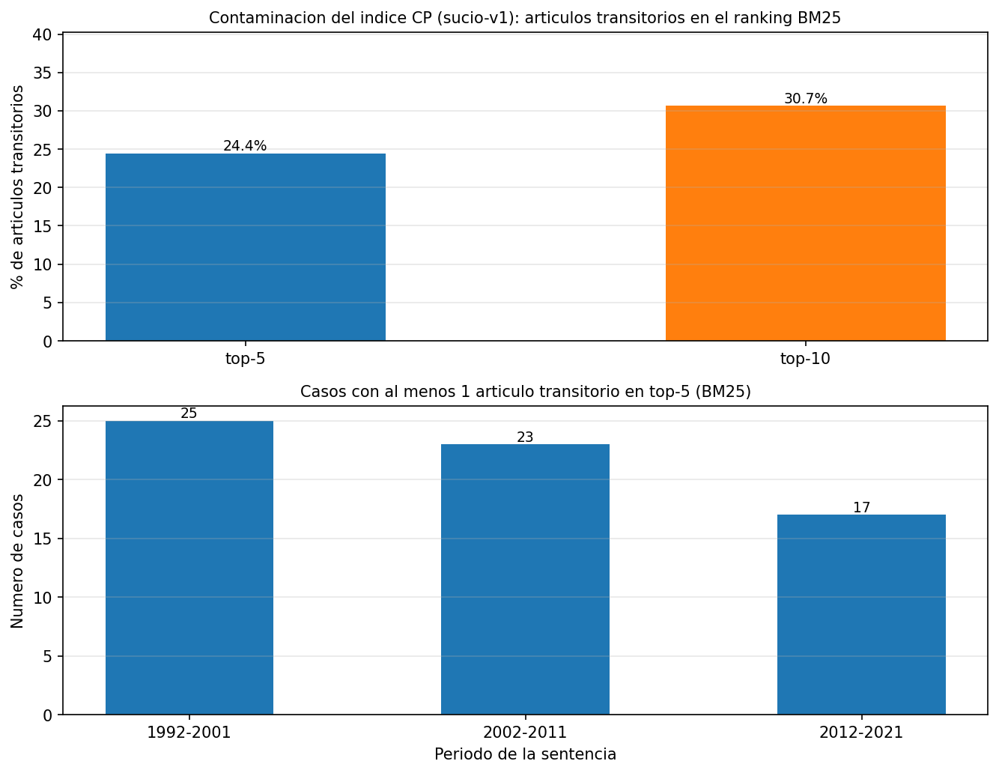
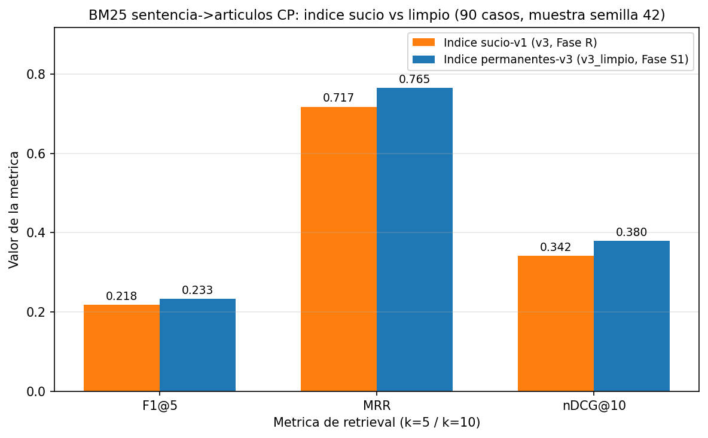
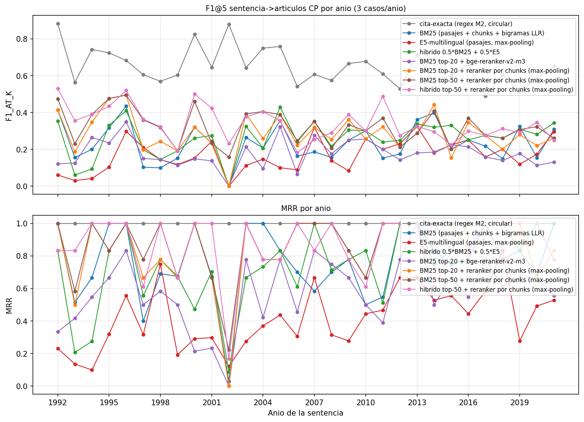
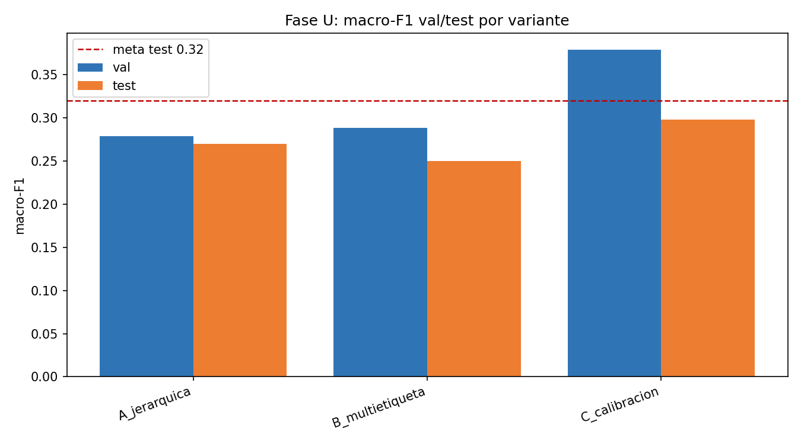
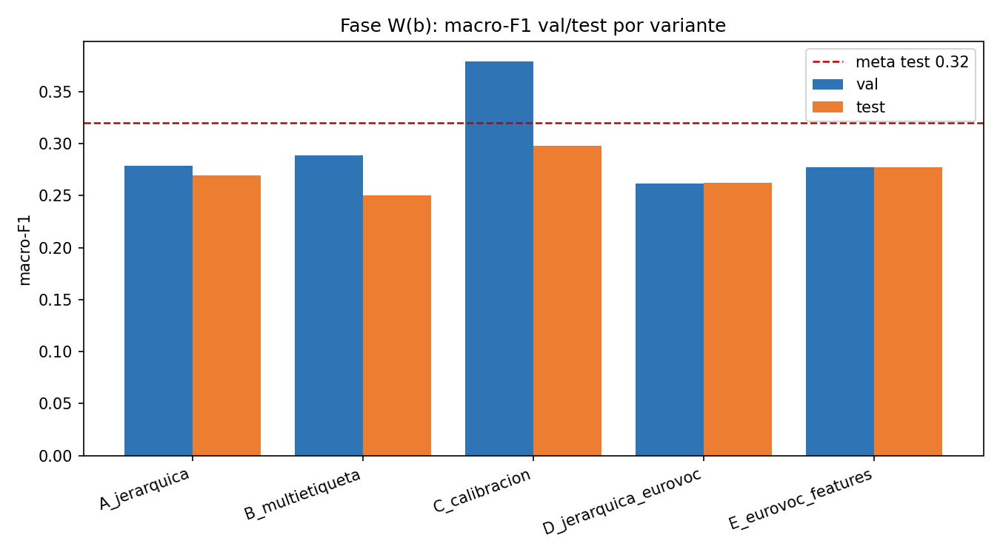

# Informe del Ciclo de Mejora v2 — "Juris-PLN" (Fase X)

**Metodología:** CRISP-DM (ciclo incremental sobre la entrega v1) · **Fecha:** 2026-09-11 · **Alcance:** vínculo CP, limpieza del índice, reranking, transformer largo, jerarquía/multietiqueta, hubs y QA · **Documento base:** `informe_final_e2.md` (v1, congelado)

---

## Resumen ejecutivo

El ciclo v2 partió de un QA v1 que validaba la estructura del producto, no su calidad caso a caso. La prueba T-6251/01 (el NER extrae los artículos 21 y 209; el retrieval recupera 0/2 con top-5 contaminado) evidenció dos fallos —índice de la CP sucio y ausencia de una segunda etapa de ranking— y un techo: con ~10,7 artículos citados por sentencia, k=5 limita el recall. El ciclo ejecutó ocho fases (R, S1, S2, T, U, V, W, X) bajo versionado estricto (ADR-11): la v1 queda congelada y los resultados nuevos se escriben con sufijo, sin sobrescribir ningún JSON previo.

El retrieval pasó de F1@5 0.218 (inicio del ciclo) a **F1@5 0.425 / MRR 0.950 / nDCG@10 0.620 / F1@10 0.379** con la ruta ganadora `hibrido_rerank_chunks_top50` + prior de hubs α=1.5, validada A/B sobre los 90 casos; la ruta default del producto (BM25 + hubs α=0.75) alcanza 0.396/0.901/0.601. La contaminación por transitorios cayó de 24,4 % a 0 %. En clasificación, ninguna variante cumplió la meta macro-F1 ≥ 0.32: la calibración de sesgos (C) logra 0.2980 en test (+3,8 % vs v1) pero no se adoptó por el gate del plan (ADR-14); jerárquico, multietiqueta y EuroVoc no aportaron. BETO con chunk-mean mejoró +17,0 %/+15,8 % sobre el BETO truncado v1 (0.2433/0.2363) pero sigue por debajo de LogReg, por lo que el producto mantiene el clasificador v1 (ADR-13). El QA de regresión v2 emitió **GO**: 10/10 casos end-to-end, drift de clasificador/validación = 0 y md5 canónicos intactos.

## 1. Motivación y diagnóstico

La v1 cerró con QA GO sobre 10 casos, pero ese QA verificaba estructura (campos, tipos, tiempos), no la calidad del ranking. El diagnóstico v2 encontró tres problemas:

1. **Índice de la CP contaminado.** El índice BM25 incluía los 112 transitorios y 45 identificadores malformados del tipo "Transitorio ACL01016-N" (códigos del Acto Legislativo 1 de 2016 en la fuente del Senado, no numeración canónica). En la Fase R, el 24,4 % del top-5 eran transitorios (65 de 90 casos) y aparecían 152 identificadores ACL malformados en el top-10.
2. **Techo de la primera etapa.** Con k=5 y una única etapa de scoring, el recall@5 sobre ~10,7 artículos de gold por sentencia queda estructuralmente capado (0.183).
3. **Métricas de IR incompletas.** El benchmark v1 no reportaba nDCG@10 (referencia BEIR) ni guardaba el top-10 por caso, lo que impedía auditar reranking y contaminación.

Quedaba una hipótesis de la v1: BETO perdió contra LogReg (0.2042 vs 0.2870) por truncar a 512 tokens (ADR-10); el ciclo probó el remedio de la literatura (chunk-mean).

**Objetivo:** medir el daño antes de arreglarlo, corregir el índice, explorar reranking, transformer largo, jerarquía/multietiqueta y señales auxiliares (hubs, EuroVoc), y adoptar solo lo que mejorara con evidencia. La v1 y sus JSON quedaron congelados como baseline (ADR-11).

## 2. Metodología

**Política de versionado (ADR-11).** Ningún `resultados/*.json` v1 se sobrescribe. Los benchmarks nuevos se escriben con sufijo (`vinculo_cp_benchmark_v3.json` … `_v8.json`) y las mejoras de código se aplican sobre los scripts vivos (`02`, `06`, `07`, `10`, `12`, `lib/componentes_producto.py`), con la versión documentada en el docstring.

**Protocolo experimental.** Benchmark de vínculo CP con 90 casos (3 por año, semilla 42, weak labels del NER, ADR-5) e índice de 497 cánones; doble escenario anti-leakage (ADR-2) en clasificación; selección por validación y test una vez; calibración A/B más full-90. Splits canónicos intactos (16.557/3.549/3.548).

| Fase | Contenido | Salida principal |
|---|---|---|
| R | nDCG@10, top-10 por caso y diagnóstico de contaminación | `vinculo_cp_benchmark_v3.json` |
| S1 | 45 IDs a Transitorio 68-112; BM25 solo permanentes (384); k=10 | `vinculo_cp_benchmark_v3_limpio.json` |
| S2 | Lectura pyarrow por filtro de id; caché de índice | 8,8 -> 5,5 s/eval; RAM 8,0 -> 1,6 GB |
| T | Reranking en dos etapas (3 iteraciones: v4/v5/v6) | `vinculo_cp_benchmark_v4/v5/v6.json` |
| U | Clasificación jerárquica (A), multietiqueta (B), calibración (C) | `m4_jerarquico.json` |
| V | BETO chunk-mean (256 tokens, stride 128, máx 64) con espejo enmascarado | `m4_transformer_chunks.json` |
| W | (a) prior de hubs de la CP; (b) EuroVoc-es auxiliar | `vinculo_cp_benchmark_v7/v8.json`, `m4_eurovoc.json` |
| X | Producto v2, QA de regresión y cierre | `qa_final_v2/VEREDICTO_QA.md` |

## 3. Resultados por fase

### 3.1 Retrieval sentencia -> artículos CP (fases R, S1, T, W-a)

| Versión | Estrategia | F1@5 | P@5 | MRR | nDCG@10 | F1@10 |
|---|---|---|---|---|---|---|
| v2 (inicio) | BM25 pasajes, índice sucio | 0.218 | 0.349 | 0.717 | — | — |
| v3 (R) | BM25, índice sucio (diagnóstico) | 0.218 | 0.349 | 0.717 | 0.342 | — |
| v3-limpio (S1) | BM25, solo permanentes | 0.233 | 0.371 | 0.765 | 0.380 | 0.218 |
| v4 (T-iter1) | Rerank con query completa (negativo) | 0.177 | 0.276 | 0.572 | 0.296 | 0.203 |
| v5 (T-iter2) | Rerank por chunks, top-20 BM25 | 0.285 | 0.456 | 0.850 | 0.438 | 0.249 |
| v6 (T-iter3) | Híbrido top-50 + rerank por chunks | 0.340 | 0.520 | 0.865 | 0.513 | 0.316 |
| **v8 (W-a iter2)** | **Híbrido top-50 + rerank + hubs α=1.5** | **0.425** | **0.638** | **0.950** | **0.620** | **0.379** |
| v8 (default) | BM25 + hubs α=0.75 | 0.396 | 0.584 | 0.901 | 0.601 | 0.398 |

*Valores redondeados a 3 decimales; fuente: `resultados/vinculo_cp_benchmark_v3..v8.json` y `resultados/metricas.json` (sección `ciclo_v2`).*

Lectura de las fases:

- **Fase R (v3).** El benchmark con nDCG@10 cuantificó el daño antes de arreglarlo: 24,4 % de transitorios en el top-5 y 45 IDs ACL malformados.
- **Fase S1 (v3-limpio).** La limpieza subió F1@5 +7,1 % (0.218 -> 0.233), MRR +6,7 % y nDCG@10 +11,0 %, sin transitorios ni IDs malformados en el top-k; los 45 códigos se mapearon a la serie canónica Transitorio 68-112 (verificados contra el Senado).
- **Fase T-iter1 (v4, negativo).** El reranking con la query completa (~68.000 caracteres) truncada a 512 tokens empeoró todo (F1@5 −24,2 %, MRR −25,2 %): el cross-encoder veía ~8 % del documento; el negativo se conserva como evidencia.
- **Fase T-iter2 (v5).** Reranking por pares (chunk, pasaje) ≤512 tokens con `bge-reranker-v2-m3` fp16: F1@5 0.285 (+22,2 % vs BM25 limpio), P@5 0.456, MRR 0.850 (2/3 metas); F1@10 0.249 por el techo de recall@20.
- **Fase T-iter3 (v6).** Ampliar candidatos al top-50 del híbrido BM25+E5 (0.5/0.5) rompió el techo: F1@5 0.340, F1@10 0.316 (+27,1 %), MRR 0.865, nDCG@10 0.513 — 3/3 metas cumplidas.
- **Fase W-a (v7/v8).** El prior estático de hubs (frecuencia global de citación por artículo, estilo IDF; top-5: 241, 86, 13, 2, 1) mejoró las 4 estrategias focales en A, B y full-90. La rejilla extendida (0 a 2.0) encontró un óptimo interior en α=1.5: F1@5 0.340 -> 0.425 (+8,5 pp), MRR 0.865 -> 0.950, nDCG@10 0.513 -> 0.620, F1@10 0.316 -> 0.379. El prior es idéntico para toda consulta (sin leakage por caso) y el PageRank de co-citación se descartó por redundante (Spearman 0.9828).

**Limitación persistente.** El caso 6251 no se rescató ni con top-50: sus artículos 21/209 estaban en las posiciones 220/305 del ranking BM25 y en 85/355 del híbrido; el reranker solo reordena candidatos existentes. Queda documentado como limitación de recall de la primera etapa, no como fallo del run.

*Figura 1. Contaminación del índice v3: transitorios en el top-5.*

*Figura 2. Efecto de la limpieza del índice (S1).*

*Figura 3. Retrieval por periodo en la versión v8.*

### 3.2 Clasificación de área (fase U y W-b)

| Variante | Macro-F1 val | Macro-F1 test | Decisión |
|---|---|---|---|
| A jerárquica (macro-grupos -> fino) | 0.2785 | 0.2697 | No adoptar |
| B multietiqueta->single-label | 0.2883 | 0.2500 | No adoptar |
| **C calibración (sesgos por clase)** | **0.3792** | **0.2980** | Candidata, no adoptada |
| D jerárquica con EuroVoc | 0.2617 | 0.2625 | No adoptar |
| E features de léxico EuroVoc | 0.2770 | 0.2771 | No adoptar |
| LogReg v1 (referencia del producto) | — | 0.2870 | Se mantiene |

C reentrena el LogReg solo con train y optimiza sesgos por clase en validación: test 0.2980 (+3,8 % vs v1; val 0.2683 -> 0.3792). La meta (0.32) no se cumplió, por lo que el gate no se superó y el producto conserva el clasificador v1 (ADR-14); C queda registrada como artefacto. B alcanza macro-F1 0.4792 / micro-F1 0.7895 en su métrica nativa (otra tarea), pero su conversión a single-label (0.2500) no compite. EuroVoc no mejoró (D −0,0355 y E −0,0209 frente a C), coherente con la cobertura parcial anticipada en E1.

*Figura 4. Variantes A, B y C de la fase U (val/test).*

*Figura 5. Variantes D y E (EuroVoc) frente a la referencia C.*

### 3.3 Transformer de documento largo (fase V)

| Modelo | Test completo | Test enmascarado | Gap leakage |
|---|---|---|---|
| BETO truncado 256+256 (v1) | 0.2080 | 0.2042 | +0.0039 |
| **BETO chunk-mean (v2)** | **0.2433** | **0.2363** | +0.0070 |

BETO con chunk-mean (52,7 chunks por documento; 5,15 h de GPU) mejoró +17,0 %/+15,8 % sobre el truncamiento v1 y confirmó ADR-10: la derrota no era del transformer sino del descarte de contexto. Las curvas de validación son monótonas (0.1503 -> 0.1935 -> 0.2313 en completo; 0.1503 -> 0.1888 -> 0.2256 en enmascarado) y el gap de leakage es ~0. La meta ≥0,26 no se alcanzó y BETO sigue por debajo de LogReg v1 (0.2870) y de C (0.2980): el producto mantiene el clasificador clásico (ADR-13).

## 4. Evidencia de SOTA usada

| Referencia | Aporte | Uso en el ciclo |
|---|---|---|
| Chalkidis et al. 2022 (arXiv:2211.00974) | Sliding-window supera al truncamiento en legales largos | Fase V |
| UA-StatuteRetrieval 2026 (arXiv:2607.11109) | Los hubs resisten el decaimiento de la co-citación | Fase W-a |
| LegalMALR 2026 (arXiv:2601.17692) | Reranking de candidatos de primera etapa, estándar 2026 | Fase T |
| Feature-Based Reranking 2026 (arXiv:2607.11400) | Combinar señales léxicas, densas y features | Fase T/W |
| BEIR (arXiv:2104.08663) | nDCG@10 como métrica estándar de IR | Fase R |
| bge-reranker-v2-m3 (HF, BAAI) | Cross-encoder multilingüe apto para la GPU local | Fase T |
| DoSSIER@COLIEE 2021 (arXiv:2108.03937, v1) | Dos etapas BM25 -> reranking BERT | Base de la Fase T |

Las seis referencias nuevas están en `references.bib` (26 entradas) y en la sección v2 de `estado_arte.md`.

## 5. QA v2 y veredicto GO

`resultados/qa_final_v2/VEREDICTO_QA.md` documenta el cierre: **GO**.

- **10/10 casos end-to-end aprobados** (8 positivas en 3 periodos + 2 negativos: Gaitán y Petro), con M0 correcto, área top-1, 10 artículos por caso y α de hubs según modo (0.75/1.5).
- **Drift de clasificador/validación = 0:** 8/8 conservan área top-1 y probabilidad (≡1e-6) del QA v1 y los negativos siguen en `false` (0.0); los cambios de retrieval son por diseño (k=5 -> 10, hubs, rerank híbrido top-50).
- **Integridad:** md5 canónicos intactos (m4_baseline `60f8fd…`, m4_jerarquico `94425f…`, m4_eurovoc `64496c…`, benchmark v8 `746621…`, prior de hubs `80ef66…`); el control negativo del script v2 falla contra los JSON v1 (82 hallazgos), confirmando que los checks discriminan ambos formatos.
- **Rendimiento:** 4-7 s por evaluación en modo default y 14-18 s en modo rerank (E5 + reranker en cuda).
- **Riesgos residuales:** caso 6251, fallback E5->BM25 probado, caché E5 sensible al número de pasajes y latencia del rerank en CPU. Rollback: componentes v1 desde `juris_pln_e2_entrega.zip`.

## 6. Lecciones y aprendizajes

1. **Nunca truncar la query de un cross-encoder en documentos largos.** La Fase T-iter1 (v4) falló por eso (−24,2 % F1@5); el reranking por pares (chunk, pasaje) revirtió el fallo y superó a v4 en +61,3 % (ADR-12).
2. **El recall de la primera etapa es el techo del reranking.** Subir candidatos de top-20 a top-50 dio +19 % F1@5 y +27 % F1@10; ningún reranker rescata un artículo fuera de los candidatos (caso 6251).
3. **Un prior estático de corpus (hubs) es barato y efectivo.** Mejora consistente en A, B y full-90, con óptimo interior (α=1.5), sin leakage por diseño y coste de una suma.
4. **En clasificación pesó más la metodología que la arquitectura.** Jerárquico, multietiqueta y EuroVoc no superaron al plano; la única mejora real (calibración, +3,8 %) no alcanzó el gate: el techo está en features/datos, no en la topología.
5. **La mejora del transformer fue metodológica, no competitiva.** Chunk-mean confirmó el diagnóstico de ADR-10 (+17 %) pero no desbancó a TF-IDF; documentar el negativo evita iteraciones infundadas.
6. **Incidentes de ingeniería resueltos y documentados.** El deadlock del DataLoader (4 runs colgados; Python 3.14 + fork, workers idle) se diagnosticó con `faulthandler` y se resolvió pre-tokenizando los chunks a disco (script 14, caché de 1,3 GB) y entrenando con `num_workers=0`; el crash de cierre de época por un `scaler.update()` faltante se corrigió tras un smoke de 2 épocas.
7. **La disciplina de versionado congelado funcionó.** Los sanity checks reprodujeron la referencia v1 exacta (0.287008), ningún benchmark previo se alteró y los negativos quedan como evidencia.

## 7. Referencias

1. Chalkidis, I., Fergadiotis, M., Malakasiotis, P., & Androutsopoulos, I. (2022). *Processing Long Legal Documents with Pre-trained Transformers: Modding LegalBERT and Longformer for Court Documents*. arXiv:2211.00974. https://arxiv.org/abs/2211.00974
2. UA-StatuteRetrieval (2026). *Temporal Decay of Co-Citation Predictability: 20-Year Statute Retrieval Benchmark from 396M Ukrainian Court Citations*. arXiv:2607.11109. https://arxiv.org/abs/2607.11109
3. LegalMALR (2026). *Multi-Agent Query Understanding and LLM-Based Reranking for Chinese Statute Retrieval*. arXiv:2601.17692. https://arxiv.org/abs/2601.17692
4. Cross-Architecture LLM Ensembles, Feature-Based Reranking and Retrieval-Augmented Prompting for Legal Information Processing (2026). arXiv:2607.11400. https://arxiv.org/abs/2607.11400
5. Thakur, N., Reimers, N., Rücklé, A., Srivastava, A., & Gurevych, I. (2021). *BEIR: A Heterogeneous Benchmark for Zero-shot Evaluation of Information Retrieval Models*. arXiv:2104.08663. https://arxiv.org/abs/2104.08663
6. BAAI (2024). *bge-reranker-v2-m3*. Hugging Face model card. https://huggingface.co/BAAI/bge-reranker-v2-m3
7. Althammer, S., Askari, A., Verberne, S., & Hanbury, A. (2021). *DoSSIER@COLIEE 2021: Leveraging dense retrieval and summarization-based re-ranking for case law retrieval*. arXiv:2108.03937.

*Las referencias 1-6 son las nuevas del ciclo v2 (26 entradas en `references.bib`); la 7 es la base metodológica de dos etapas heredada de la v1.*

## 8. Anexos: rutas de artefactos

| Artefacto | Ruta |
|---|---|
| Benchmarks vínculo CP | `resultados/vinculo_cp_benchmark_v3.json` … `_v8.json` (7 archivos) |
| Clasificación | `resultados/m4_jerarquico.json`, `resultados/m4_eurovoc.json` |
| Transformer | `resultados/m4_transformer_chunks.json` (v1 intacto: `m4_transformer.json`) |
| Métricas consolidadas | `resultados/metricas.json` (sección `ciclo_v2`) |
| QA v2 | `resultados/qa_final_v2/VEREDICTO_QA.md` + 10 JSON de casos + logs + entradas |
| Scripts | `13`, `14`, `15` (nuevos); `02`, `06`, `07`, `10`, `12`, `lib/` (modificados) |
| ADRs | `plan/decisiones/` ADR-11 a ADR-15 |
| Figuras del ciclo | `figuras/` (contaminación v3-v8, deriva v3-v8, hubs α v7/v8, comparación sucio/limpio, variantes U/EuroVoc) |
| Reproducción | `06 --fase-u`, `07 --estrategia chunk_mean`, `12 [--calibrar-hubs]`, `14_precache_chunks_beto.py`, `checks_qa_final.py` (v2); detalle en README "Ciclo v2" |
| Entrega | `PROYECTO/juris_pln_e2_entrega_v2.zip` |
