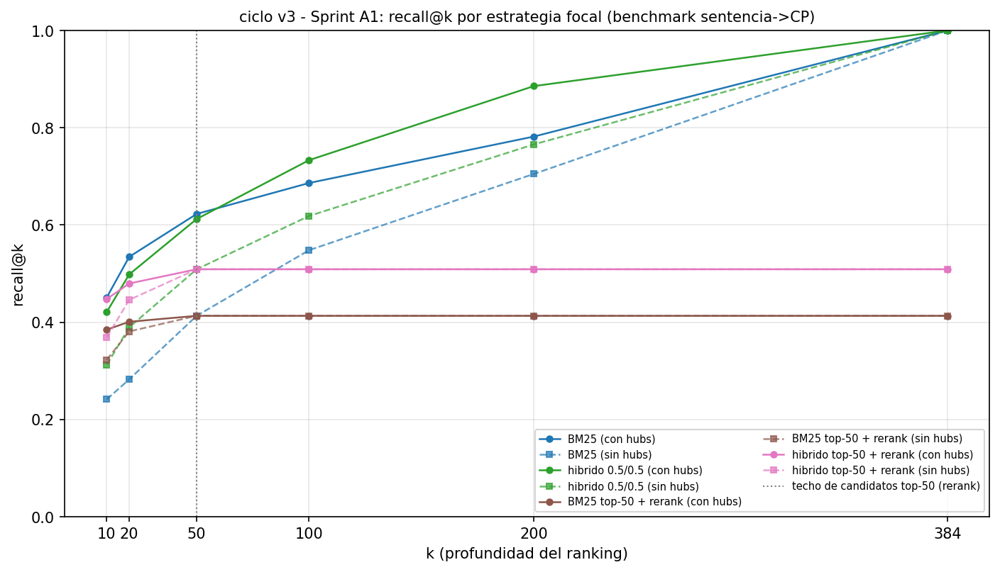
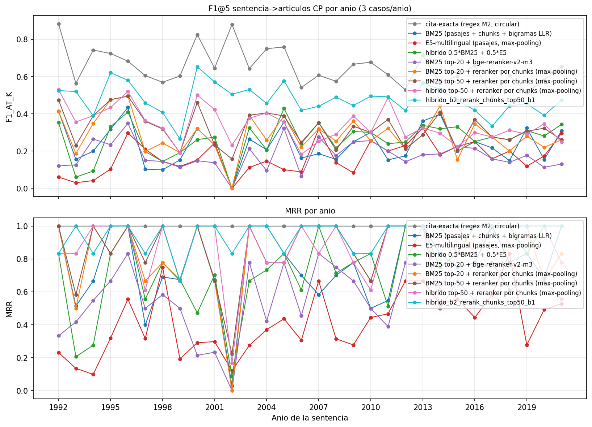
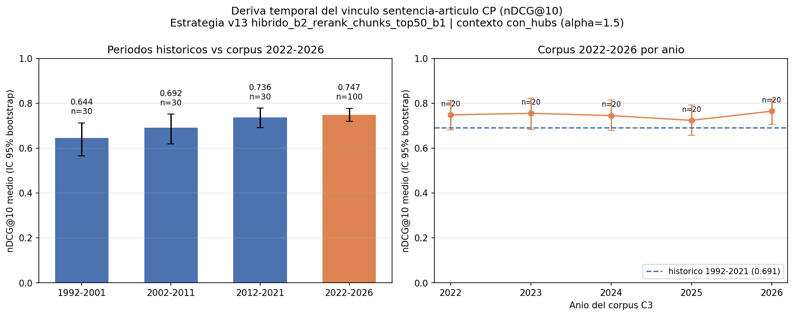
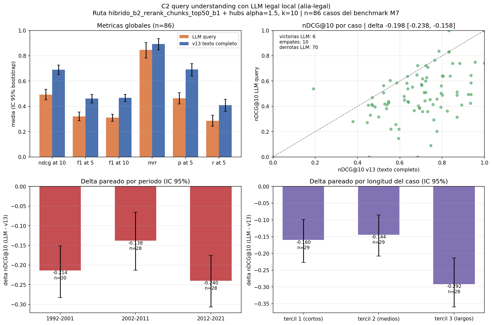

# Informe del Ciclo v3 — "Juris-PLN" (recuperación robusta)

**Metodología:** CRISP-DM (ciclo incremental sobre las entregas v1/v2) · **Fecha:** 2026-10-05 · **Alcance:** Sprint A, Sprint B (adopción v2.2), B3, C2, C3, Fase 1 (auditoría de ruido M4, H1/H2/H2b, O1) y QA v2.2 · **Documento base:** `informe_final_ciclo_v2.md` (v2, congelado)

---

## Resumen ejecutivo

El ciclo v3 partió de una auditoría de Fase 1 con tres diagnósticos: objetivo de evaluación disperso (metas medidas contra una referencia automática, sin protocolo estadístico uniforme de adopción), M4 estancada en un macro-F1 bajo (0,2870) y ruido del silver no cuantificado hasta entonces (31,8 % de issues OOF con cleanlab). Se ejecutaron dos sprints (A y B) y tres frentes técnicos (C2, C3, Fase 1) bajo versionado congelado (ADR-16) y gates de IC 95 % bootstrap pareado + consistencia A/B.

El **Sprint A no adoptó ninguna variante** (ADR-17): cinco experimentos sobre 90 casos mostraron que embeddings y rerankers legales ES, fusiones alternativas y candidatos de clasificación no superaban a la ruta v2 con evidencia; los smokes n=10 engañaron en 2 de 3 ocasiones. El **Sprint B** entrenó dos modelos de dominio con citas propias —reranker B1 y retriever denso B2— y la ruta `híbrido BM25+B2 → rerank B1 → hubs α=1,5` alcanzó **nDCG@10 0,6926/0,6907 (sin/con hubs), F1@5 0,478 y MRR 0,950** (90 casos, silver), con Δ pareado vs v12 de **+0,0673 [+0,0418;+0,0892]** y **+0,0617 [+0,0381;+0,0852]**. Se **adoptó el producto v2.2** (ADR-18) y el QA v2.2 emitió **GO**. El mini-gold pre-anotado con LLM (B3, proxy) confirmó B2 > B1 > v8 (0,783 [0,733;0,829] vs 0,685/0,707; Δ +0,098; kappa inter-LLM 0,651). C3 (2.382 descargadas, 2.330 documentos) no mostró deriva: nDCG@10 **0,747 [0,719;0,777]** vs 0,691 histórico. C2 cerró **negativo zero-shot** (Δ −0,198 query; −0,217 rerank), con LoRA como vía futura. En M4 no se adoptaron la auditoría de ruido ni H1/H2/H2b; O1 quedó como proxy (0,415/0,299; kappa inter-LLM 0,230) con anotación humana pendiente.

## 1. Motivación y diagnóstico

La v2 cerró con QA GO y F1@5 0,425, pero la meta del plan v3 (nDCG@10 ≥ 0,70 con gold humano, ≥ 0,60 por periodo) seguía sin poder auditarse con la referencia disponible. La auditoría de Fase 1 fijó tres problemas:

1. **Objetivo disperso.** El benchmark usaba citas NER (silver, sin verificación humana) y las adopciones previas no seguían un criterio estadístico único. El v3 pre-registró el gate (ADR-16): Δ en la métrica norte con IC 95 % bootstrap pareado + consistencia A/B, con gold graduado como control.
2. **M4 con macro-F1 bajo.** LogReg en 0,2870; la meta 0,32 no se alcanzó en v2 y faltaba determinar cuánto del techo era ruido del silver.
3. **Ruido del silver.** cleanlab cuantificó 31,8 % de issues OOF en train y 31,09 % out-of-sample en test.

A ello se sumaban el cuello de recall de la primera etapa (caso 6251 fuera del top-50) y un reranker genérico (bge) sin adaptación al dominio constitucional colombiano. El plan v3 atacó ambos con modelos de dominio entrenados sobre citas propias, un LLM legal local (ALIA-7B) y una extensión del corpus a 2022-2026.

## 2. Metodología

**Premisas transversales (verificadas en cada experimento):**

- **Terminología estricta silver/gold.** *Silver* = referencia automática del NER; *gold* = anotación humana. B3 y O1 son proxies LLM, no gold humano.
- **Gates de adopción.** Solo se adopta si el Δ en la métrica norte supera el ruido con IC 95 % bootstrap pareado (1000 remuestreos, semilla 42) y es consistente en mitades A/B. Los smokes (n=10) no deciden gates.
- **Anti-leakage.** Los entrenamientos de dominio excluyen las 90 sentencias del benchmark; el holdout de M4 (2.481 documentos) permanece sellado para el gate final; el test canónico se lee una vez y nunca se calibra en test.
- **Trazabilidad.** Resultados congelados con sufijo (`_v9+`, `c3_*`), un script por experimento y negativos conservados con igual rigor (ADR-16).
- **Proxies etiquetados.** Las pre-anotaciones LLM (B3, O1) se reportan con caveat de verificación automática; los gates humanos formales siguen abiertos.

| Frente | Contenido | Salida principal |
|---|---|---|
| Sprint A | Diagnóstico con IC/recall, embeddings y rerankers legales ES, fusiones, clasificador | `c3_diagnostico_recall.json`, `vinculo_cp_benchmark_v9..v11.json`, `m4_clasificador_c3.json` (ADR-17) |
| Sprint B | B1 reranker de dominio, B2 retriever denso, B3 mini-gold | `vinculo_cp_benchmark_v12/v13.json`, `c3_b1_reranker.json`, `c3_b2_retriever.json`, `gold_mini/` (ADR-18) |
| C2 | LLM ALIA zero-shot: query understanding y rerank listwise | `resultados/c2_llm/` (negativo) |
| C3 | Corpus 2022-2026: descarga, preparación y evaluación temporal | `data/corpus_2022_2026/`, `c3_descarga_stats.json`, `c3_preparacion_stats.json`, `c3_eval_temporal.json` |
| Fase 1 | Auditoría de ruido M4, H1/H2/H2b, O1 | `m4_ruido_etiquetas.json`, `m4_h1_ruido_v1.json`, `m4_h2_objetivo_suave_v1.json`, `m4_h2b_postproceso_v1.json`, `validacion_m4/` |
| QA v2.2 | Integración B2+B1 y regresión v3 | `resultados/qa_final_v2_2/`, `scripts/checks_qa_final_v3.py` |

## 3. Resultados por frente

### 3.1 Sprint A — diagnóstico y modelos legales ES: sin adopciones (ADR-17)

Cinco experimentos sobre 90 casos (test canónico en A5) cerraron sin cambios al producto. **A1** cuantificó el techo: recall de candidatos top-50 del híbrido 0,509 (bm25 0,413), techo silver F1@5 ≤ 0,649 y aporte de hubs +0,108 de nDCG@10 al reranker genérico. **A2** comparó cuatro embeddings legales ES: ALIA-MrBERT logró el mejor recall de primera etapa (0,723 @100 vs 0,619 de E5) y mejora significativa en F1@10 con hubs (+0,017 [+0,001;+0,031]), pero el nDCG@10 no ganó con IC → ALIA pasó al Sprint B. **A3** midió el reranker SINAI y un RRF de rangos: SINAI perdió con IC (−0,143 sin hubs; −0,055 con hubs) y RRF no ganó (−0,007/−0,020). **A4** mostró que ninguna fusión (w03, w07, rrf1a) gana a w05 0,5/0,5 y que top-50 es la profundidad recomendada (Δ +0,027 [+0,014;+0,039] sin hubs; no inferior con hubs; top-200 rechazado). **A5** no adoptó C, el ensamble con BETO chunk-mean ni class weights: C vs v1 dio Δ +0,011 [−0,023;+0,030] (IC cruza 0) y el ensamble quedó en 0,2901 < 0,2980.

### 3.2 Sprint B — modelos de dominio y adopción del producto v2.2 (ADR-18)

**B1 (reranker de dominio).** Fine-tune de `bge-reranker-v2-m3` con 299.999 pares de citas propias (150.000 positivos / 149.999 negativos: aleatorios 52,8 %, co-citados 29,9 %, BM25 17,3 %), excluyendo las 90 del benchmark; mejor checkpoint en el paso 10.000 (val AUC 0,8513). En v12 superó a bge sin hubs (nDCG@10 0,625 [0,590;0,663] vs 0,512 [0,470;0,554]; Δ +0,113; F1@10 +0,071) y empató con hubs (0,629 vs 0,620; Δ +0,009, no concluyente): los hubs compensaban al reranker genérico, no al de dominio. El gate no se cumplió con B1 solo (0,629 < 0,66).

**B2 (retriever denso de dominio).** Fine-tune contrastivo de `ALIA-MrBERT-es-legal-administrative-embeddings` con las tripletas/pares de B1 (143.004 + 96.328; 1 época, 3.762 pasos; val: acc. tripletas 0,6864, recall@10 0,3616). Evaluación v13 de la ruta `híbrido BM25+B2 → rerank B1 → hubs α=1,5`:

| Métrica (90 casos, silver) | v13 sin hubs | v13 con hubs | Δ pareado vs v12 (B1+E5) |
|---|---|---|---|
| nDCG@10 | **0,6926** [0,657;0,725] | **0,6907** [0,654;0,725] | +0,0673 [+0,0418;+0,0892] / +0,0617 [+0,0381;+0,0852] |
| F1@10 | 0,447 [0,420;0,473] | 0,464 [0,436;0,493] | +0,0610 [+0,0395;+0,0815] / +0,0681 [+0,0481;+0,0895] |
| F1@5 | **0,478** | — | — |
| MRR | **0,950** | — | — |

El umbral del gate (nDCG@10 ≥ 0,66) se superó en ambos contextos, la mejora pareada vs v12 y vs A2/ALIA@100 ganó con IC y no hubo caídas por periodo (0,499/0,485/0,450, por encima de la mejor ruta previa en cada uno). F1@5 0,478 es el mejor valor no circular del proyecto. Con B3 (proxy) y el QA, la ruta `--rerank` del producto pasó a B2+B1 con hubs α=1,5; el default (BM25 + hubs α=0,75) quedó intacto y los fallbacks a E5/bge documentados.

*Figura 1. Diagnóstico A1: recall@k por estrategia y techo de candidatos top-50.*

*Figura 2. Comportamiento por periodo de la ruta ganadora v13 (sin caídas).*

### 3.3 B3 — mini-gold graduado con pre-anotación LLM (proxy, no humano)

Sobre 50 casos y 820 candidatos, una pre-anotación ciega con LLM local (qwen3.8) asignó grados 2/1/0 (164/146/510) y la evaluación graduada dio nDCG@10 0,783 [0,733;0,829] para B2, 0,685 (pool 0,707) para B1, 0,566 (pool 0,617) para v8 y 0,644 para cita-exacta; el pareado B2 vs B1 fue +0,098 [0,069;0,128]. Un segundo anotador LLM (gemma4, 12 casos/174 ítems) corroboró el proxy: kappa 0,651 ("sustancial", po 0,839). El análisis de consistencia mostró mayor coincidencia con las citas NER y con el top-10 de B2 (24,0 % grado-2 en citados vs 11,5 % fuera; 0/50 casos sin grado-2). **Caveat:** verificación automática, no humana; el spot-check humano sigue pendiente y el gate humano formal permanece abierto.

### 3.4 C3 — corpus 2022-2026 y robustez temporal

La extensión descargó 2.382 providencias 2022-2026 (474/584/530/520/274 por año), con 2.334 HTML válidos y 48 stubs aún no publicados; quedaron 2.330 documentos utilizables (4 con texto corto). La preparación replicó el pipeline histórico: NER con cobertura CP 99,96 %, etiquetado por cita 99,96 %, lemas completos (55,2 M tokens). La evaluación temporal con la ruta v13 sobre 100 casos (20/año, silver) dio **nDCG@10 0,747 [0,719;0,777]**, F1@5 0,442, F1@10 0,472, MRR 0,99 y P@5 0,822, con valores por año estables (0,748/0,755/0,745/0,724/0,764) frente al 0,691 histórico. El delta es descriptivo (muestras, corpus y etiquetas distintos; no pareado): **no hay evidencia de deriva temporal** de la ruta v2.2. Nota de auditoría: las cifras C3 no viven en una sección `c3_deriva_temporal` de `metricas.json` (esa clave no existe); la fuente es `resultados/c3_eval_temporal.json`.

*Figura 3. nDCG@10 por año en el corpus 2022-2026 frente al histórico.*

### 3.5 C2 — LLM legal ALIA zero-shot: negativo documentado

**C2(a) query understanding:** ALIA extrajo consultas en 86/90 casos; la ruta con consulta-LLM obtuvo nDCG@10 0,493 [0,453;0,536] vs 0,691 de v13; Δ −0,198 [−0,238;−0,158]. **C2(b) rerank listwise:** 90/90 reordenamientos; nDCG@10 0,473 [0,429;0,516] vs 0,691; Δ −0,217 [−0,258;−0,175]; la latencia sí cumplió el gate (media 7,1 s; p95 11,4 s; ≤30 s). Interpretación documentada: ALIA (administrativo español) produce consultas cortas/genéricas y juicios fuera de dominio para el constitucional colombiano; vía futura: LoRA con datos propios.

*Figura 4. C2(a): consulta-LLM frente a texto completo sobre v13.*

### 3.6 M4 — auditoría de ruido del silver y variantes de Fase 1

La auditoría con cleanlab reprodujo la referencia v1 exacta (macro-F1 test 0,287008; espacio fijo 0,2691) y cuantificó el ruido: 31,81 % de issues OOF en train (5.266/16.557), 31,09 % out-of-sample en test, macro-F1 OOF 0,2597, IC95 test [0,2461;0,2912] y baseline mayoritaria 0,0374. Con soporte ≥100, las clases más ruidosas fueron rama_ejecutiva (0,767), derechos_sociales (0,434) y principios_fundamentales (0,321). Ninguna de las tres hipótesis derivadas se adoptó: **H1** no superó al baseline v1r (val: v2 −0,0267, v3 −0,0154; suplemento no visto: v1r 0,2301 > v3 0,2049 > v2 0,1976; test dev 0,2464 < 0,2691 de v1); **H2** dio W2 +0,0344 [−0,0051;+0,0749] (p=0,128) y W3 −0,0208, sin ganador ni lecturas de test; **H2b** halló un ganador val-específico (P1 +0,1716 IC>0, A/B consistente) que degrada en temporal (−0,1642/−0,1611 en macro-F1 fijo; acc −0,178). **O1** añadió dos proxies LLM sobre 200 documentos: exactitud vs silver 0,415 (gemma4, kappa 0,269) y 0,299 (qwen, kappa 0,203), con kappa inter-LLM 0,230; el acuerdo bajo apoya que el silver es difícil/ruidoso, pero no valida su calidad: la anotación humana sigue pendiente.

### 3.7 QA v2.2 — veredicto GO

El QA de la adopción (`resultados/qa_final_v2_2/`) emitió **GO** (exit 0, reverificado de forma independiente): 10/10 casos end-to-end; integridad md5 de canónicos v2 (5) y componentes B2/B1 (8); equivalencia producto↔benchmark 3/3 exacta (ids y scores); default byte-comparable con `qa_final_v2` salvo `tiempo_segundos`; controles negativos discriminan (v2: 8 fallos; v1: 92). Latencias de runs limpios: default 4,64-5,51 s y rerank 13,90-14,51 s (QA completo bajo contención: 4,15-7,27 s y 15,81-23,03 s), todas ≤10/≤30 s; `checks_qa_final_v3.py` 10/10. Nota de auditoría: la cifra "13,9-16,3 s" de ADR-18 no reproduce exactamente en `metricas.json`; este informe usa la del JSON. Riesgos residuales: barrido md5 pendiente, `TOP10_ESPERADO` hard-coded y ausencia de control humano B3; rollback desde `juris_pln_e2_entrega_v2.zip`.

## 4. Métodos elegidos, premisas y criterios de adopción

**Criterio de adopción (ADR-16, aplicado en todos los frentes).** (1) La métrica norte debe mejorar con IC 95 % bootstrap pareado (1000 remuestreos, semilla 42) y prob. de mejora ≥ 0,95; (2) la mejora debe ser consistente en mitades A/B o en ambos contextos (con/sin hubs); (3) el costo debe ser compatible con la latencia declarada; (4) los smokes no deciden gates; (5) todo negativo se documenta con la misma evidencia que un positivo.

**Métodos elegidos.** Retrieval: default BM25 + hubs α=0,75 (sin cambios) y ruta `--rerank` con **B2 + B1 + hubs α=1,5** (ADR-18). Clasificación: LogReg v1 enmascarado (sin cambios). Señal auxiliar: prior de hubs de la CP (vigente). **No adoptados:** embeddings alternativos (A2), reranker SINAI/RRF (A3), fusiones/profundidad (A4), calibración C y ensamble (A5), LLM ALIA zero-shot (C2) y H1/H2/H2b.

**Premisas de la evidencia humana.** Todo resultado contra citas NER es *silver*; B3 (gold-LLM + check gemma4) y O1 (dos LLM) son **proxies automáticos**. Las decisiones se tomaron con la mejor evidencia disponible, dejando explícito el gate humano abierto: mini-gold M7 (spot-check 10-15 casos) y O1 (200 documentos) son los pendientes que lo cerrarían formalmente.

## 5. Comparativa v1 → v2 → v3

| Dimensión | v1 (2026-09-10) | v2 (2026-09-11) | v3 / producto v2.2 (2026-10-05) |
|---|---|---|---|
| Vínculo CP — ruta | BM25 pasajes (índice sucio) | Híbrido top-50 + bge + hubs α=1,5 | Híbrido BM25+B2 + rerank B1 + hubs α=1,5 |
| F1@5 (90 casos, silver) | 0,218 | 0,425 | **0,478** |
| MRR | 0,717 | 0,950 | **0,950** |
| nDCG@10 | no medido (retro: 0,342 sucio) | 0,620 | **0,6926 / 0,6907** (sin/con hubs) |
| F1@10 | no medido | 0,379 | **0,447 / 0,464** |
| Control graduado | — | — | gold-LLM B3: **0,783** [0,733;0,829] (proxy) |
| Deriva temporal | — | estable por periodo | C3 2022-2026: **0,747** vs 0,691 (sin deriva) |
| Clasificación M4 (macro-F1 test) | 0,2870 | 0,2870 (C 0,2980 no adoptada) | 0,2870 (31,8 % ruido OOF; H1/H2/H2b sin adopción) |
| QA | GO (10/10, 16/16 métricas) | GO (10/10, drift 0) | GO v2.2 (10/10, equivalencia exacta, checks v3 10/10) |

Cada adopción elevó la calidad del vínculo CP sin tocar la latencia declarada; la clasificación se mantuvo por disciplina de gate y ahora cuenta con un diagnóstico cuantificado del techo (ruido del silver, no solo modelo).

## 6. Trabajo futuro

Resumen fiel de `plan/PENDIENTES_Y_FUTURO.md` (2026-10-05):

**A. Pendientes de anotación humana.** (i) **B3 mini-gold (M7):** **COMPLETADO (2026-10-05)** — Carlos anotó los 820/820 candidatos (50/50 casos) y el gate humano confirmó la adopción v2.2 (ver adenda; `resultados/gold_mini/`, `16_anotador_gold.py`). (ii) **O1 (M4):** muestra de 200 documentos con 2 proxies (0,415/0,299); falta anotación humana (3-10 h) con `21_pack_validacion_m4.py`. (iii) **C1 gold estándar 150 (M7):** no iniciado; la herramienta de B3 sirve de base.

**B. Trabajo futuro técnico.** (1) **C2-LoRA:** fine-tuning LoRA de ALIA-7B con datos propios (pares de citas B1 + casos), única vía restante del frente LLM. (2) **2ª época de B2:** requiere modo `--continuar` en el script 25 (candidato lr 1e-5 desde el checkpoint de época 01). (3) **B4:** BETO chunk-mean++ (más épocas / max_chunks 96), retorno probablemente bajo. (4) **M4 tras O1:** H3 (agregación aprendida de chunks), features por secciones/boilerplate y clases raras (cRT/aumentación); no repetir class weights/calibración/jerárquico/EuroVoc. (5) **Calibración de probabilidades del producto** (temperature/isotonic) o marcarlas como no calibradas. (6) **Reintento de los 48 stubs de C3** y **unificación de C3 con el corpus principal.** (7) **Demo interactiva (streamlit)**, opcional. (8) **Barrido md5 completo** de artefactos congelados (observación del QA v2.2), pendiente. (9) **Reemplazo terminológico** "silver NER" → "silver" en documentos antiguos de `plan/`.

**C. Cierre del ciclo v3 (en ejecución).** C5: informe + deck + README de entrega; C6: comparativa v1→v2→v3 (arriba); C4: consolidación del producto v3 (v2.2 técnica + QA v2.2); git: commit local en `feature/e2-ciclo-v3` (push/PR pendiente de credenciales; git solo bajo pedido); reindex de codebase-memory tras el commit.

**D. Criterios para retomar.** Gates: IC 95 % bootstrap + A/B; smokes no deciden. Los gates finales de F2 deben usar el **holdout sellado** (`data/holdout_m4_bloqueado.parquet`). Anti-leakage: excluir las 90 sentencias del benchmark en todo entrenamiento de dominio. Terminología: silver = automático; gold = humano.

## 7. Referencias y evidencia externa

1. Northcutt, C. G., Jiang, L., & Chuang, I. L. (2021). *Confident Learning: Estimating Uncertainty in Dataset Labels*. JMLR 22(137), 1-41. (cleanlab)
2. Landis, J. R., & Koch, G. G. (1977). *The Measurement of Observer Agreement for Categorical Data*. Biometrics 33(1), 159-174.
3. Sakai, T. (2007). *Alternatives to Bpref*. SIGIR 2007, 71-78.
4. Chalkidis, I., et al. (2022). *Processing Long Legal Documents with Pre-trained Transformers*. arXiv:2211.00974.
5. Thakur, N., et al. (2021). *BEIR: A Heterogeneous Benchmark for Zero-shot Evaluation of Information Retrieval Models*. arXiv:2104.08663.
6. SINAI Research Group. *ALIA-MrBERT-es-legal-administrative-embeddings* y *…-reranker*. Hugging Face (Apache-2.0).
7. SINAI Research Group. *ALIA-es-legal-administrative-7B-Instruct*. Hugging Face (Apache-2.0).
8. BAAI (2024). *bge-reranker-v2-m3*. Hugging Face model card.
9. LegalMALR (2026). *Multi-Agent Query Understanding and LLM-Based Reranking for Chinese Statute Retrieval*. arXiv:2601.17692.

*Las referencias 1-3 son las nuevas del ciclo v3; las 4-9 provienen del estado del arte ya verificado en `references.bib`.*

## 8. Anexo: artefactos por sección

| Sección | Artefactos |
|---|---|
| Sprint A | `resultados/c3_diagnostico_recall.json`, `vinculo_cp_benchmark_v9/v10/v11.json`, `c3_a3_rerankers.json`, `c3_a4_fusion_profundidad.json`, `m4_clasificador_c3.json`, `figuras/c3_*.png` |
| Sprint B (B1/B2) | `resultados/vinculo_cp_benchmark_v12/v13.json`, `c3_b1_reranker.json`, `b1_pares.json`, `c3_b2_retriever.json`, `b2_entrenamiento_v1.json`, `modelos/b1_reranker/`, `modelos/b2_retriever/`, `figuras/deriva_retrieval_v12/v13.png`, `fig_b2_entrenamiento.png` |
| B3 | `resultados/gold_mini/` (muestra, candidatos, guía, respuestas LLM, evaluación, acuerdo), `scripts/16_anotador_gold.py`, `scripts/27_preanotacion_gold_llm.py` |
| C2 | `resultados/c2_llm/` (queries, rerank, metas y evaluaciones), `figuras/c2_query_llm.png`, `figuras/c2_rerank_llm.png`, `scripts/30/31` |
| C3 | `data/corpus_2022_2026/`, `resultados/c3_descarga_stats.json`, `c3_preparacion_stats.json`, `c3_eval_temporal.json`, `figuras/c3_deriva_temporal.png`, `scripts/26/28/29` |
| Fase 1 (M4/O1) | `resultados/m4_ruido_etiquetas.json`, `m4_h1_ruido_v1.json`, `m4_h2_objetivo_suave_v1.json`, `m4_h2b_postproceso_v1.json`, `protocolo_evaluacion_m4.json`, `data/splits_m4_temporal.parquet`, `data/holdout_m4_bloqueado.parquet`, `resultados/validacion_m4/`, `figuras/fig_*.png` |
| QA v2.2 | `resultados/qa_final_v2_2/` (10 JSON + logs + entradas), `scripts/checks_qa_final_v3.py`, sección `qa_v2_2` de `metricas.json` |
| Consolidado | `resultados/metricas.json` (`ciclo_v3`, `b1_reranker`, `b2_retriever`, `b3_*`, `c2_*`, `o1_validacion_llm_multi`, `auditoria_etiquetas_m4`, `h1/h2/h2b`), `plan/REGISTRO_EXPERIMENTOS.md`, ADRs 16-18 |
| Reproducción | Scripts `16`-`31` + `checks_qa_final_v3.py`; detalle en README "Ciclo v3" |

---

## Adenda (2026-10-05): gate B3 con gold humano

El 2026-10-05 Carlos completó la anotación humana graduada del mini-gold de B3: 820/820 candidatos y 50/50 casos (grados 2/1/0: 189/267/364), cerrando el gate humano que las secciones 3.3 y 6 dejaban abierto. El acuerdo ítem a ítem con el proxy LLM (qwen) fue moderado —kappa de Cohen 0,345 (po 0,594; n=820; nivel "aceptable" según Landis y Koch)—, con una distribución humana menos extrema (más grados 1 y 2) que la del LLM; carlos|gemma4 dio kappa 0,370 (n=174) y el Fleiss de tres evaluadores 0,445 (174 ítems). Pese a esa varianza por ítem, las métricas agregadas de ranking convergen con el proxy: en nDCG@10, B2 0,7852 (humano) vs 0,7831 (LLM) y B1 0,6903 vs 0,6850, con el mismo orden de rutas (B2 > B1 > v8).

La evaluación con gold humano (50 casos, IC bootstrap 1000/semilla 42) confirma el gate del ciclo: B2 (v13) nDCG@10 **0,7852 [0,745;0,826]**, nDCG@5 0,7674, P@5 0,796, R@5 0,520 y recall graduado@10 0,772; B1 (v12) 0,6903 [0,645;0,739]; v8 0,5700; cita-exacta 0,6812. Las comparaciones pareadas ganan con IC: B2 vs B1 Δ +0,0948 [+0,0668;+0,1239] (prob. 1,0), B2 vs v8 +0,2152 y B1 vs v8 +0,1204 (pool +0,0869). Con ello, la meta del plan v3 (nDCG@10 ≥ 0,70 con gold humano) se cumple y el **gate B3 humano CONFIRMA la adopción del producto v2.2 (ADR-18)**, que deja de ser "adopción respaldada por proxy". Queda declarada como caveat la varianza del juicio humano por ítem. Artefactos: `resultados/gold_mini/respuestas_carlos.jsonl` (md5 67ce4f0a…), `acuerdo_gold_mini.json` (md5 63ad1902…) y `evaluacion_gold_mini.json` (md5 04124c05…); las salidas solo-LLM previas quedaron respaldadas en `backup/`. El pendiente de O1 (anotación humana de 200 documentos) permanece abierto.
