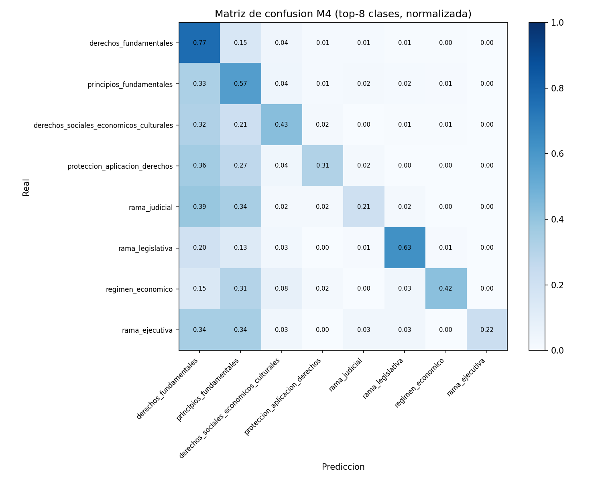
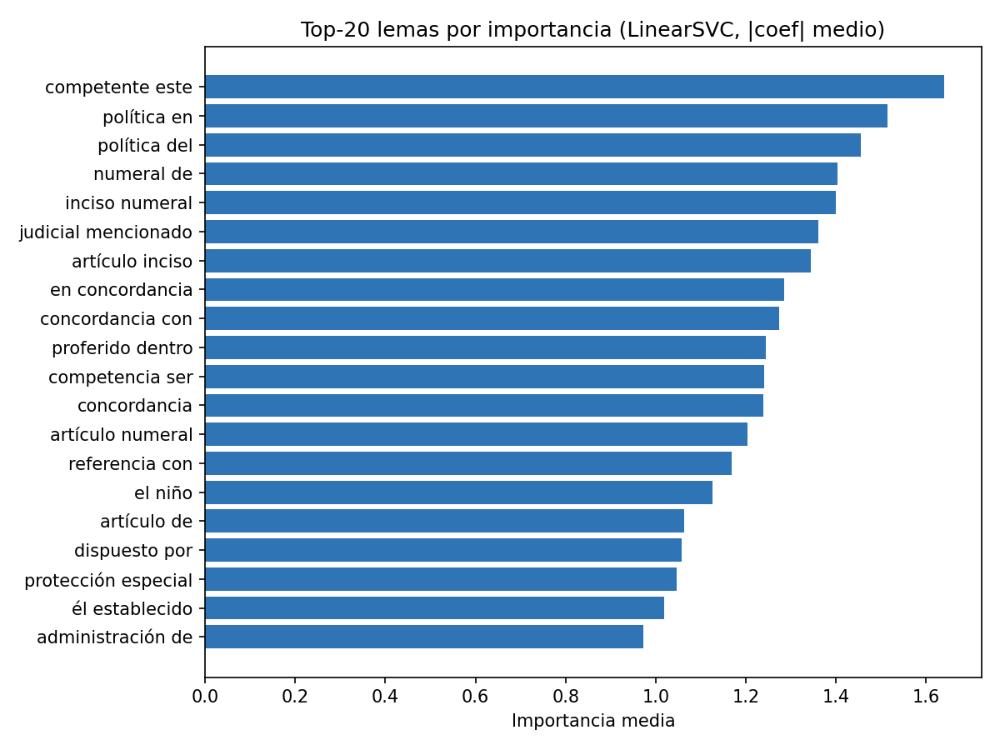
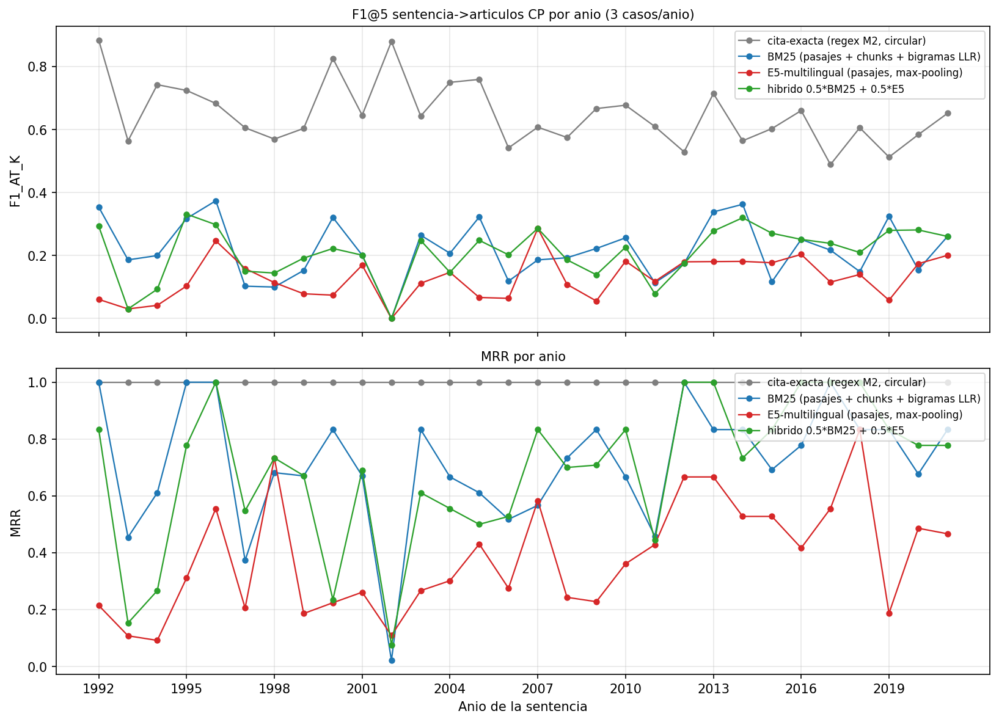
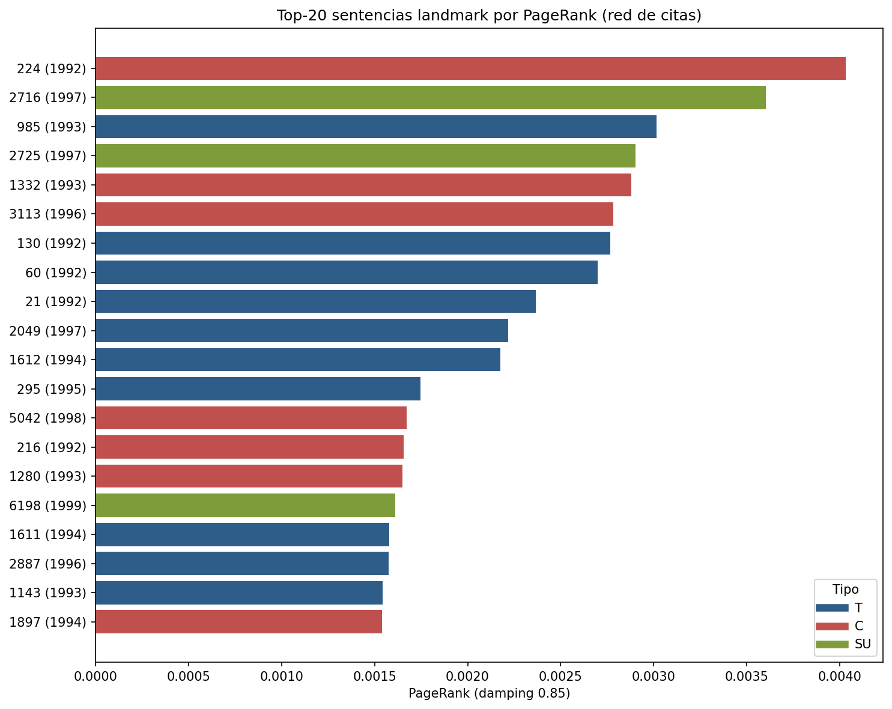
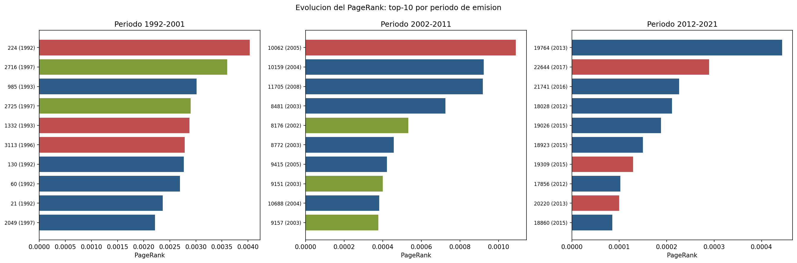
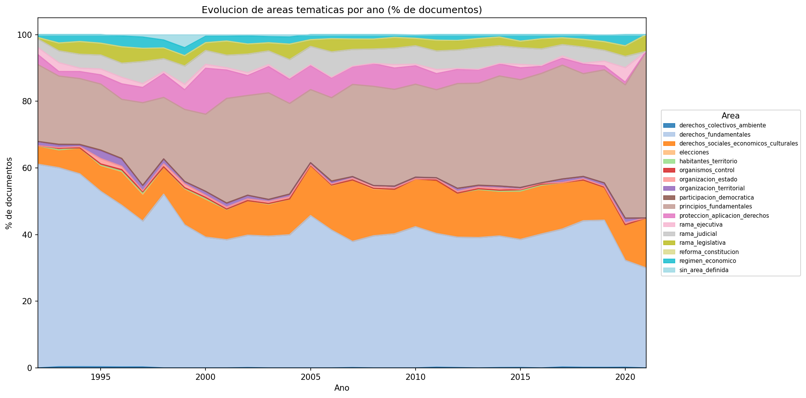
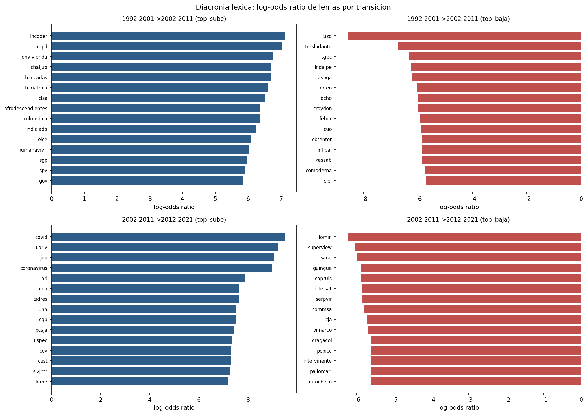
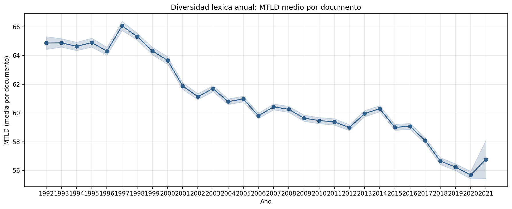

# Informe Final E2 "Juris-PLN" — Sistema de PLN sobre sentencias de la Corte Constitucional de Colombia (1992-2021)

**Metodología:** CRISP-DM · **Fecha:** 2026-09-09 · **Corpus:** 23.742 sentencias (T 17.099 / C 6.246 / SU 397), ~261M palabras crudas · **Reproducibilidad:** semilla 42, splits generados una sola vez, scripts 00-12 + `lib/`

---

## 1. Comprensión del Negocio

La Corte Constitucional de Colombia publica desde 1992 un archivo de providencias que hoy supera los 23.700 documentos y 261 millones de palabras. Ese volumen hace inviable la lectura manual para juristas, investigadores y litigantes que necesitan responder preguntas concretas: ¿este texto es una providencia de la Corte?, ¿de qué área del derecho constitucional trata?, ¿qué artículos de la Constitución Política (CP) la sustentan?, ¿qué red de precedentes la rodea?

El objetivo de E2 es construir **Juris-PLN**, un sistema que, dada una sentencia (o cualquier texto de entrada): (1) valida si es providencia de la Corte Constitucional (M0), (2) clasifica su área temática constitucional en 16 clases derivadas de la estructura de la CP (M4), (3) recupera los artículos de la CP vinculados, de forma robusta a la deriva de redacción en 30 años (M7), y (4) sitúa la sentencia en su red de precedentes con métricas de centralidad (M5) y análisis diacrónico 1992-2021 (M6).

Los criterios de éxito acordados en `plan/PLAN.md` (fases A-O): etiquetas reproducibles con cobertura >= 95 %, benchmark de clasificación 2x2 (modelo x escenario anti-leakage), benchmark de vínculo CP con estratificación temporal, producto end-to-end funcional con sentencias reales, y trazabilidad completa (cada cifra en un JSON de `resultados/`).

## 2. Comprensión de los Datos

**Fuente:** dataset `Manuel/sentencias-corte-cons-colombia-1992-2021` (Hugging Face, CC-BY-4.0), CSV `Juris1992_2022.csv` de 1.561 GB con 23.750 filas (columnas ID y Texto). La migración a Parquet (ADR-7, PySpark 4.2.0 local[*], Java 17) excluyó 8 filas que no son sentencias (6 autos A-xxx y 2 archivos HTML corruptos), verificando que las posiciones coinciden con lo detectado en E1. El corpus final queda en 23.742 sentencias: 17.099 tutelas (T), 6.246 de constitucionalidad (C) y 397 de unificación (SU), distribuidas en 1992-2021 (2021 con solo 20 documentos).

**Cifras canónicas heredadas de E1** (verificadas en `plan/PLAN.md`): 260.988.316 palabras crudas, 250.012.101 limpias, 128.806.664 sin stopwords (~48 % del texto son stopwords, 306 formas normalizadas más 65 jurídicas); promedio 10.992,68 palabras crudas y 10.530,37 limpias por sentencia; parseo regex del encabezado 99,97 %. La limpieza E1 se portó verbatim a PySpark y se verificó 100 % coincidente (23.742/23.742 documentos con igual `n_palabras_clean` que la referencia de E1).

**Constitución Política de 1991** (M3, Fase G): descargada de la fuente oficial del Senado (HTTP), parseada a 497 filas: 384 artículos permanentes (1-380, incluidos 22A/178A/238A/257A) + 112 transitorios + preámbulo, agrupados en 19 bloques temáticos. Spot-check 5/5 correcto. Salida: `data/constitucion_articulos.parquet/.json`.

## 3. Comprensión de los Datos: EDA (resumen)

El EDA extendido se ejecutó como sección 9 del notebook de E1 (celdas 0-23 intactas, verificadas por diff; 18 celdas nuevas, 42/42 sin errores), con resultados detallados en la entrega E1. Hallazgos relevantes para E2:

- **N-gramas:** top bigrama "corte constitucional" (286.786), top trigramo "accion de tutela" (344.893): el léxico está dominado por fórmulas institucionales, lo que motivó las stopwords jurídicas.
- **Colocaciones:** gana likelihood-ratio (75 % de fórmulas válidas vs 55 % de frecuencia y 0 % de PMI) -> LLR adoptado para M2/M4 (bigramas de colocaciones).
- **Lema vs stem (corpus completo):** lemas preservan 87,3 % del vocabulario (195.959 tipos) vs 54,2 % de los stems (121.696); en muestra de 50 términos el stem trunca ("derech") y el lema conserva ("derechos"->"derecho"). Coste: spaCy 5.227 s vs Snowball 1.171 s (pago único, background reanudable).
- **POS:** distribución NOUN > ADP > DET > ADJ; las sentencias C llevan VERB en el top-5 (vs PROPN en T/SU).
- **MTLD por tipo:** T 61,63 > C 59,54 > SU 58,88.
- **Granularidad (ADR-8):** el corpus no trae doble salto de línea, por lo que párrafo = sentencia (600/600); la subsentencia solo tiene marcador temático en 4,64 % de unidades y no supera el criterio pre-registrado de +15 % de pureza -> la unidad de análisis es la **sentencia completa**.

## 4. Preparación de los Datos

### 4.1 Migración a Parquet (ADR-7)

CSV 1.561 GB -> Parquet Hive `tipo=/ano=` 1.465 GB (341 archivos), columnas (id, tipo, numero, ano, texto, texto_limpio). Tiempo 237,5 s, RAM pico 7,78 GB. Incidente de ingeniería: Java 26 (por defecto) es incompatible con Spark 4.2.0 (`ClassNotFoundException: jdk.internal.ref.Cleaner`); se fijó `JAVA_HOME` a Java 17 existente (`/usr/lib/jvm/java-17-openjdk`), documentado en ADR-7.

### 4.2 NER jurídico (M2, Fase H)

`03_extraccion_entidades.py` (regex + ventana de 60 caracteres) extrae artículos CP citados, normas, sentencias citadas y ponente. Precisión muestral (100 docs, seed 42, 20 por tipo): arts_cp 1.00, normas 1.00, sents_resuelve_corpus 0.90, sents_rango_valido 1.00, ponente 1.00. Cobertura global (% docs con >= 1): cita CP 98,71 %, norma 99,67 %, sentencia citada 99,94 %, ponente 85,38 % (decae a 57,28 % en 2017-2021). Top artículos citados: 241 (20.289 docs), 86 (16.405), 13 (8.757). Aristas doc->cita: 540.181 con self-loops, 516.529 sin ellos. Salida: `data/entidades_sentencias.parquet` (23.742 x 7).

### 4.3 Etiquetado de áreas (M3, Fase I, ADR-1)

Cada artículo citado se normaliza al canon de la CP y se mapea a su bloque temático; el área primaria es el bloque mayoritario (desempate por menor número de artículo). Fallback "derecho a X" -> derechos_fundamentales para documentos sin citas CP. Resultado: **99,63 % asignadas** (cita_cp 98,71 % = 23.436; fallback 0,92 % = 218; sin área 0,37 % = 88), muy por encima del criterio >= 95 %. Distribución: derechos_fundamentales 42,46 % (10.081), principios_fundamentales 27,59 % (6.551), sociales 12,05 % (2.861); 16 clases efectivas (3 bloques CP quedan vacíos por diseño: preámbulo, transitorios, deberes). Las 16 clases están fuertemente desbalanceadas (de 42,46 % a 0,01 %), lo que anticipa la dificultad de la clasificación.

### 4.4 Lematización (M1, Fase J)

`05_lematizacion.py` procesó 23.742/23.742 documentos en background (6.807 s) con checkpoints por id y reanudación automática (usada 3 veces tras 2 OOMs por contención de RAM con procesos externos). Vocabulario de lemas: 195.959 tipos, 100 % coincidente con los contadores del EDA. Salida: `data/lemas_por_doc.parquet` (646 MB). Incidente: spaCy `max_length` 1M < documento máximo de 3M chars -> `nlp.max_length=5M` + guard try/except por documento.

### 4.5 Splits (una sola vez, seed 42)

70/15/15 estratificados sobre los 23.654 documentos etiquetados: 16.557/3.549/3.548 (train/val/test), sin solapes ni duplicados (verificado por el QA final). Los splits se generaron una única vez antes de todos los experimentos M4/BETO y no se regeneraron.

## 5. Modelado

### 5.1 M0 — Validación de entrada

Heurística de 3 reglas (anexo 25 del plan) sobre el encabezado: decide si el texto es providencia de la Corte. Benchmark: 30 positivos (1/año 1992-2021, estratificados por tipo) + 22 negativos (discursos de posesión presidencial del corpus `open_corpus_co_es`, de Gaitán 1942 a De la Espriella 2026).

| Métrica | Valor |
|---|---|
| TP / FP / TN / FN | 30 / 0 / 22 / 0 |
| Accuracy | **1.0** (52 casos) |

Fuente: `resultados/m0_validacion.json`.

### 5.2 M4 — Clasificación de área temática (16 clases)

**Baseline clásico** (`06_baseline_clasico.py`): TF-IDF sobre lemas (100k features, ngram 1-2, min_df 3) + LinearSVC y LogisticRegression, con selección Optuna (15 trials). **Doble escenario anti-leakage (ADR-2):** texto completo vs texto con citas enmascaradas. Benchmark 2x2 (macro-F1 test):

| Modelo | Completo | Enmascarado | Gap leakage |
|---|---|---|---|
| LinearSVC | 0.2654 | 0.2657 | -0.0003 |
| **LogReg (mejor)** | 0.2852 | **0.2870** | -0.0018 |
| BETO fine-tuned | 0.2080 | 0.2042 | +0.0039 |

Accuracy del mejor modelo: ~59 %. Fuente: `resultados/m4_baseline.json` y `resultados/m4_transformer.json`.

**Auditoría adversarial de leakage (gate L2):** el reviewer RECHAZÓ la primera versión del enmascarado (enmascaraba 0.7 citas/doc cuando el promedio real es 10.7; los números arábigos ya no existen en los lemas por `is_alpha` y los núcleos de cita llevan tilde, "artículo"). La v2 corregida (núcleos con tilde + romanos estrictos + series) deja un gap de -0.0018 (el enmascarado es incluso ligeramente mejor). **Prueba de oro:** un modelo entrenado solo con features de cita alcanza F1 0.0611 ~= azar -> no hay leakage activo; el clasificador aprende contenido temático.

**Transformer** (`07_transformer.py`): BETO `dccuchile/bert-base-spanish-wwm-cased`, 3 épocas, batch efectivo 32, lr 2e-5, truncamiento cabeza+cola 256+256 tokens (ADR-3), 6h40m de GPU (el guard de VRAM esperó 3h05m a que un proceso externo liberara la GPU). Curvas de entrenamiento sanas (val macro-F1 0.13 -> 0.19 -> 0.21 en ambos escenarios, sin saturar).

**ADR-10: LogReg gana a BETO.** Las sentencias promedian ~11k palabras; la ventana de 512 tokens descarta ~95 % del contenido (incluidas las secciones de fondo donde vive la señal temática), mientras que TF-IDF sobre lemas procesa el documento completo. El resultado es consistente con Chalkidis et al. (2022) sobre documentos legales largos, donde los modelos de bolsa de palabras son competitivos o superiores a los transformers. El producto conserva LogReg; BETO queda guardado como comparativa en `modelos/m4_transformer/`.

*Figura 1. Matriz de confusión del mejor clasificador M4 (LogReg enmascarado, macro-F1 0.2870) sobre el conjunto de test (3.548 docs, 16 clases). Las confusiones se concentran entre áreas vecinas de la CP (p. ej. derechos_fundamentales vs principios_fundamentales).*

*Figura 2. Importancias |coef| medio del mejor modelo lineal (equivalente SHAP lineal, generado por el propio script): dominan bigramas de fórmula jurídica ("competente este", "política en") y rasgos temáticos ("el niño", "protección especial").*

### 5.3 M7 — Vínculo sentencia -> artículos CP (retrieval)

Protocolo ADR-5: weak labels = citas reales extraídas por el NER (M2), benchmark estratificado temporalmente (3 sentencias/año 1992-2021, 90 casos, cupos proporcionales al tipo), métricas P@5/R@5/F1@5/MRR. La recalibración v2 (Fase K-2) rediseñó el retrieval tras refutar una hipótesis con evidencia del corpus.

**ADR-9 — Hallazgo estrella:** la hipótesis de "ventana corta de query" (usar solo los considerandos iniciales) fue **REFUTADA**: la primera cita a la CP aparece a mediana en el 41 % del texto (solo 29,5 % en el primer cuarto) y el sweep de ventanas muestra degradación monótona al recortar (ventana 3.000 chars: F1@5 0.127 vs texto completo 0.204). La mejora real vino de: (1) indexar la CP por **pasajes** (931 pasajes de 497 artículos) con max-pooling por artículo, (2) query = **texto completo en chunks** (512 tokens, solape 64) con max-pooling por chunk, (3) stopwords jurídicas + bigramas LLR del EDA (ablation 0.218 vs 0.206 sin ellos).

| Estrategia | F1@5 | MRR |
|---|---|---|
| Cita-exacta (referencia circular) | 0.649 | 1.0 |
| **BM25 v2 (pasajes + max-pooling)** | **0.218** | **0.717** |
| Híbrido BM25+E5 (0.5/0.5) | 0.209 | 0.688 |
| E5 (multilingual-e5-base) | 0.128 | 0.382 |
| BM25 v1 (artículo completo) | 0.119 | 0.544 |

Mejora v1 -> v2: **+84 %** en F1@5. La cita-exacta es referencia circular (el mismo regex M2 que generó las weak labels; recall de extracción 1.0 reportado aparte), no un competidor legítimo: mide el techo de la extracción explícita. La deriva temporal del v1 no se mantiene con la muestra ampliada: BM25 es estable por periodo y E5/híbrido mejoran en 2012-2021 (híbrido F1@5 0.256 en el último periodo). El gap restante (0.218 vs 0.649) motiva usar la extracción explícita de citas como feature de ranking en el producto. Fuente: `resultados/vinculo_cp_benchmark_v2.json`.

*Figura 3. Métricas de retrieval por periodo (1992-2001 / 2002-2011 / 2012-2021) para las estrategias v2: BM25 estable en el tiempo; E5 e híbrido mejoran en el periodo reciente.*

### 5.4 M5 — Red de citas y precedentes

`08_red_citas.py` construye el grafo dirigido de citas resueltas al corpus: 23.742 nodos, **456.321 aristas** (84,48 % de las 540.181 citas únicas resuelven a un documento del corpus; 60.208 quedan no resueltas con su año extraído), 7.688 componentes fuertemente conexas, componente gigante 67,6 % (16.050 nodos). PageRank global: dominan los **landmarks fundacionales** — C-224/1992 (0.00403), SU-2716/1997 (0.00360), T-985/1993 (0.00301) — casi todos de derechos_fundamentales. La evolución por periodo muestra que la Corte cita cada vez más sus precedentes recientes: en 1992-2001 el top-10 PageRank vive en 1992-1997; en 2012-2021, en 2012-2017. Fuente: `resultados/red_citas.json`.

*Figura 4. Red de citas de la Corte Constitucional (23.742 nodos, 456.321 aristas resueltas) con los nodos de mayor PageRank: los landmarks fundacionales C-224/1992 y SU-2716/1997 encabezan la centralidad.*

*Figura 5. Evolución del PageRank por periodo: los precedentes dominantes en cada década son cada vez más recientes, evidencia de que la Corte construye sobre su propia jurisprudencia inmediata.*

### 5.5 M6 — Diacronía (1992-2021)

`09_diacronia.py` compara el primer trienio (1992-1994) con el último (2019-2021):

- **Áreas:** crece principios_fundamentales **+20,2 pp** (23,1 % -> 50,0 % en 2021) y decae derechos_fundamentales **-24,2 pp** (61,1 % -> 30,0 %): la agenda temática de la Corte migró de la tutela de derechos hacia los principios constitucionales.
- **Léxico (log-odds, min 50 apariciones):** en 1992-2001 -> 2002-2011 suben incoder, rupd, fonvivienda, bancadas (reforma agraria y política); en 2002-2011 -> 2012-2021 suben covid (9,51), uariv, jep (9,04), coronavirus (8,97): el léxico refleja el ciclo conflicto armado -> posacuerdo -> pandemia.
- **MTLD:** desciende de 64,9 (1992) a 56,8 (2021), tendencia -0.319/año: la prosa es hoy menos diversa léxicamente.

*Figura 6. Evolución anual del porcentaje de sentencias por área temática: principios_fundamentales crece +20,2 pp y derechos_fundamentales cae -24,2 pp entre el primer y el último trienio.*

*Figura 7. Transiciones léxicas por log-odds entre décadas: incoder/rupd/bancadas (2002-2011) ceden ante covid/jep/coronavirus (2012-2021).*

*Figura 8. MTLD medio por año (1992-2021): descenso sostenido de 64,9 a 56,8 (tendencia -0.319/año).*

### 5.6 Producto end-to-end (Fase N)

`10_evaluar_sentencia.py` (CLI: `--archivo|--id|--texto`, `--salida`) + `lib/componentes_producto.py` (5 clases). Dado un texto produce un JSON con: validación M0, ponente, área top-3 con probabilidades (vía clasificador M4 LogReg enmascarado), artículos CP extraídos (regex M2) + top-5 BM25 (M7), citas resueltas con PageRank y área del precedente (M5), y resumen. Demo: T-293/97 (true, derechos_fundamentales 0.9429, 6 artículos extraídos + 5 BM25), C-002/98 (true, 0.934, 18+5, 4 citas con PageRank), discurso de Gaitán (false, score 0.0, sin análisis). Tiempo: ~9 s por evaluación con índice BM25 cacheado.

## 6. Evaluación

### 6.1 QA final del producto (veredicto GO)

`resultados/qa_final/VEREDICTO_QA.md`: prueba end-to-end sobre 10 casos estratificados (8 positivos del corpus, 2 por periodo, con mezcla T/C/SU; 2 negativos: discursos de Gaitán y Petro). **10/10 casos pasaron** todos los checks (es_sentencia correcto, área top-1 con prob en (0,1], artículos > 0, BM25 == 5, 120 citas resueltas cruzadas contra el parquet de la red sin errores de año/PageRank/área, tiempos < 30 s, máximo 11,37 s). **Consistencia de métricas: 16/16 cifras canónicas verificadas** contra los JSON registrados, sin drift entre lo reportado y lo medido. Checklist de entrega completo (ruff limpio, modelos cargables, splits intactos, semilla 42 documentada, rollback posible). Decisión: **GO**, sin bloqueantes.

### 6.2 Auditoría de rendimiento

`resultados/qa_final/AUDITORIA_RENDIMIENTO.md` (perfilado real: perf_counter, cProfile, RSS, GPU): 8,7-12,7 s por sentencia en frío (1,2-5,0 s en caliente), CPU-only verificado (0 bytes de VRAM), RAM pico 8,1 GB. **El cuello de botella es de inicialización, no algorítmico:** ~75 % del tiempo frío es lectura del corpus completo (3,7 s, ~42 %) + carga lazy de spaCy (2,9 s, ~33 %); la inferencia escala linealmente solo con la longitud del documento (no con el número de citas: 51 citas se resuelven en < 1 ms). Veredicto: OK para entrega académica; recomendaciones opcionales (leer solo la fila pedida, modo lote, vectorizar BM25) documentadas.

### 6.3 Anti-leakage como evaluación transversal

El doble escenario (ADR-2) se aplicó a todos los modelos de área: gap LogReg -0.0018, gap BETO +0.0039, ambos ~= 0. La auditoría adversarial L2 detectó y corrigió un enmascarado v1 inválido (0.7 citas/doc enmascaradas vs 10.7 reales), y la prueba de oro (features de cita solas -> F1 0.0611 ~= azar) confirmó que no hay atajos de cita. Este es un hallazgo metodológico central del proyecto: las etiquetas derivadas de citas (ADR-1) no se filtraron como leakage en ningún modelo.

## 7. Conclusiones

**Hallazgos principales:**

1. **Anti-leakage con auditoría adversarial:** el protocolo de doble escenario + gate de reviewer detectó un enmascarado roto (v1) que habría validado métricas con evidencia insuficiente; la v2 corregida y la prueba de oro (F1 0.0611 ~= azar) garantizan que el clasificador aprende contenido temático, no atajos de cita.
2. **LogReg+TF-IDF lemas > BETO (0.2870 vs 0.2042):** en documentos de ~11k palabras, la ventana de 512 tokens descarta ~95 % del contenido; consistente con la literatura de LJP en textos legales largos (Chalkidis et al. 2022). Los transformers no son automáticamente superiores en este régimen de corpus.
3. **ADR-9, hipótesis refutada con evidencia:** la ventana corta de query empeora (1ª cita a mediana en el 41 % del texto); la mejora real del retrieval (+84 % F1@5) vino de pasajes por artículo + max-pooling de chunks + stopwords jurídicas + bigramas LLR.
4. **La red de citas muestra una Corte que se apoya en precedentes cada vez más recientes**, aunque los landmarks fundacionales (C-224/1992, SU-2716/1997) dominan la centralidad global.
5. **Deriva temática y léxica medible:** derechos_fundamentales -24,2 pp vs principios +20,2 pp; el léxico transita del conflicto (incoder, rupd) al posacuerdo (jep, uariv) y la pandemia (covid); MTLD desciende 64,9 -> 56,8.
6. **Ingeniería reproducible bajo contención de recursos:** Java 26 -> 17, OOMs por GPU/RAM compartidas resueltos con guards de VRAM, checkpoints por id y reanudación automática, spaCy max_length 5M. Todos los incidentes documentados en `plan/ESTADO_Y_PENDIENTES.md`.

**Limitaciones documentadas (con mitigación):**

- **Macro-F1 0.2870 es modesto** (16 clases muy desbalanceadas, 8 con < 1 %): el top-1 puede confundir áreas vecinas. Mitigación: el producto expone top-3 con probabilidades para decisión informada.
- **Resolución de citas 84,5 %:** 60.208 cánones citados no resuelven al corpus (sentencias fuera de él); el campo `resuelta` lo distingue explícitamente.
- **M0 validado con 52 casos:** muestra pequeña para la heurística 2/3; un documento judicial de otra corte podría pasar M0 (los negativos probados, discursos presidenciales, se rechazan correctamente).
- **Cita-exacta es referencia circular** (mismo regex que generó las weak labels); su F1@5 0.649 es techo de extracción, no baseline legítimo.
- **Weak labels en M7:** no hay ground truth experto de "artículos que sustentan cada sentencia"; las citas extraídas son proxy documentado (ADR-5).

## 8. Trabajo Futuro

1. **Chunk-mean pooling para BETO** (ADR-3 variante b): promediar embeddings [CLS] de todos los chunks cubriría el 100 % del documento; descartado esta iteración por presupuesto de GPU compartida (~20x el tiempo), pero las curvas sin saturar (0.13 -> 0.21) sugieren que BETO podría cerrar la brecha con más épocas.
2. **LEGAL-BERT en español / dominio legal:** adaptación de dominio sobre el propio corpus (Chalkidis et al. 2020) como siguiente paso neuronal.
3. **Re-ranking cruzado top-50 -> E5 por pares** en M7 (siguiente iteración SOTA, ADR-9), y usar la extracción explícita de citas como feature de ranking para cerrar el gap 0.218 -> 0.649.
4. **Optimización de ingeniería del producto:** leer solo la fila pedida del Parquet (-42 % tiempo frío), modo lote con proceso persistente, y vectorizar el scoring BM25 (rank_bm25 es Python puro).
5. **Embeddings diacrónicos** (Hamilton et al. 2016) por lustro para medir deriva semántica de términos constitucionales ("tutela", "territorio ancestral").
6. **Validación extendida de M0** con documentos de otras cortes (Consejo de Estado, Corte Suprema) y anotación experta muestral de las etiquetas de área.

## Referencias

1. Manuel (2022). *sentencias-corte-cons-colombia-1992-2021* [dataset, Hugging Face, CC-BY-4.0]. https://huggingface.co/datasets/Manuel/sentencias-corte-cons-colombia-1992-2021
2. Anzola Cortés, J. S. (2021). *Algoritmos, sentencias y derecho constitucional comparado: explorando el uso de jurisprudencia extranjera en Colombia* [trabajo de grado, Universidad de La Sabana]. https://hdl.handle.net/10818/47728
3. Barbosa Becerra, J. J. M. (2021). Comportamiento discursivo del enunciado "territorio ancestral" en las sentencias de la Corte Constitucional de Colombia. *Estudios de Derecho, 78*(172). https://doi.org/10.17533/udea.esde.v78n172a10
4. Soh, J., Lim, H. K., & Chai, I. E. (2019). Legal Area Classification: A Comparative Study of Text Classifiers on Singapore Supreme Court Judgments. *NLLP Workshop 2019*, 67-77. https://doi.org/10.18653/v1/W19-2208
5. HaCohen-Kerner, Y., Miller, D., & Yigal, Y. (2020). The influence of preprocessing on text classification using a bag-of-words representation. *PLOS ONE, 15*(5), e0232525. https://doi.org/10.1371/journal.pone.0232525
6. González-González, J., de Arriba-Pérez, F., García-Méndez, S., Busto-Castiñeira, A., & González-Castaño, F. J. (2023). Automatic explanation of the classification of Spanish legal judgments in jurisdiction-dependent law categories with tree estimators. *JKSU-CIS, 35*(7), 101634. https://doi.org/10.1016/j.jksuci.2023.101634
7. Raj, A. Y., V, G. R. N., Mishra, A. N., & Basha, M. S. A. (2026). Collective Bargaining in Karnataka Public Sector Undertakings: A Computational Analysis of Indian Court Judgments Using NLP and Machine Learning. *IECCT 2026*, IEEE, 1-6. https://doi.org/10.1109/IECCT68664.2026.11541803
8. Aletras, N., Tsarapatsanis, D., Preoţiuc-Pietro, D., & Lampos, V. (2016). Predicting judicial decisions of the European Court of Human Rights: a Natural Language Processing perspective. *PeerJ Computer Science, 2*, e93. https://doi.org/10.7717/peerj-cs.93
9. Chalkidis, I., Fergadiotis, M., Malakasiotis, P., Aletras, N., & Androutsopoulos, I. (2020). LEGAL-BERT: The Muppets straight out of Law School. *Findings of EMNLP 2020*, 2898-2904. https://doi.org/10.18653/v1/2020.findings-emnlp.261
10. Löffler, C., Martínez Freile, A., & Rey Pizarro, T. (2025). Predicting potentially abusive clauses in Chilean terms of services with natural language processing. *Artificial Intelligence and Law*. https://doi.org/10.1007/s10506-025-09462-w
11. Chalkidis, I., Fergadiotis, M., & Androutsopoulos, I. (2021). MultiEURLEX -- A multi-lingual and multi-label legal document classification dataset for zero-shot cross-lingual transfer. *EMNLP 2021*, 6974-6996. https://doi.org/10.18653/v1/2021.emnlp-main.559
12. Althammer, S., Askari, A., Verberne, S., & Hanbury, A. (2021). DoSSIER@COLIEE 2021: Leveraging dense retrieval and summarization-based re-ranking for case law retrieval. arXiv:2108.03937.
13. Fink, T., Recski, G., Kusa, W., & Hanbury, A. (2023). Statute-enhanced lexical retrieval of court cases for COLIEE 2022. *JURISIN 2022*. arXiv:2304.08188.
14. Samy, D. (2021). Reconocimiento y clasificación de entidades nombradas en textos legales en español. *Procesamiento del Lenguaje Natural, 67*, 103-114.
15. Dozier, C., Kondadadi, R., Light, M., Vachher, A., Veeramachaneni, S., & Wudali, R. (2010). Named Entity Recognition and Resolution in Legal Text. En *Semantic Processing of Legal Texts* (LNAI 6036, 27-43). Springer. https://doi.org/10.1007/978-3-642-12837-0_2
16. McCarthy, P. M., & Jarvis, S. (2010). MTLD, vocd-D, and HD-D: A validation study of sophisticated approaches to lexical diversity assessment. *Behavior Research Methods, 42*(2), 381-392. https://doi.org/10.3758/BRM.42.2.381
17. Hamilton, W. L., Leskovec, J., & Jurafsky, D. (2016). Diachronic Word Embeddings Reveal Statistical Laws of Semantic Change. *ACL 2016*. arXiv:1605.09096.
18. Fowler, J. H., Johnson, T. R., Spriggs, J. F., Jeon, S., & Wahlbeck, P. J. (2007). Network Analysis and the Law: Measuring the Legal Importance of Precedents at the U.S. Supreme Court. *Political Analysis, 15*(3), 324-346. https://doi.org/10.1093/pan/mpm011
19. Cañete, J., Chaperon, G., Fuentes, R., Ho, J.-H., Kang, H., & Pérez, J. (2020). Spanish Pre-Trained BERT Model and Evaluation Data. *PML4DC @ ICLR 2020*. arXiv:2308.02976.
20. Wang, L., Yang, N., Huang, X., Jiao, B., Yang, L., Jiang, D., Majumder, R., & Wei, F. (2022). Text Embeddings by Weakly-Supervised Contrastive Pre-training. arXiv:2212.03533.

*Nota: las 20 referencias provienen de `references.bib` (verificadas por DOI/URL el día de su investigación; ver `estado_arte.md`). Chalkidis et al. (2022) citado en ADR-10 para el hallazgo LogReg>BETO corresponde a la línea de trabajo de documentos legales largos del mismo autor (MultiEURLEX 2021, ref. 11).*
