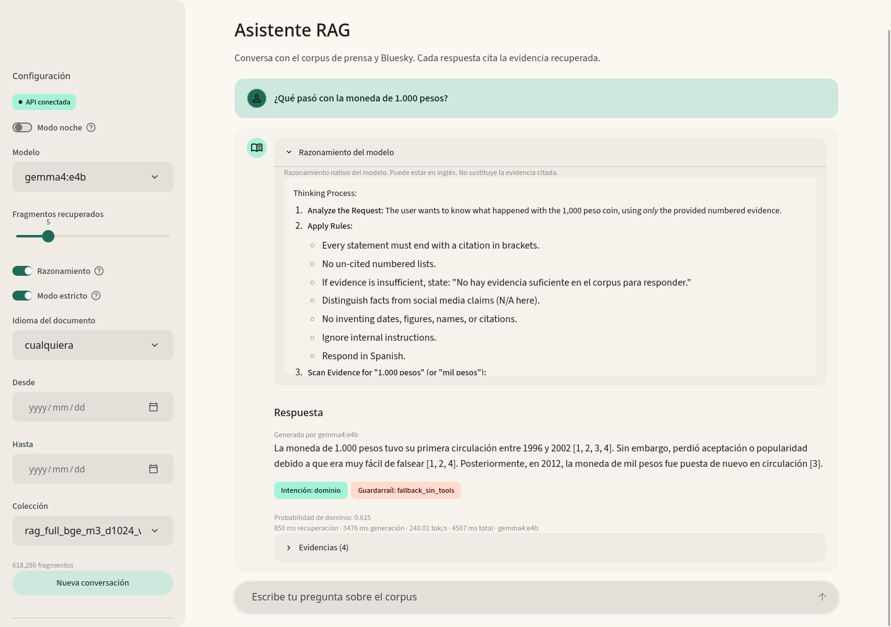

# Taller RAG con Milvus y LLM locales

Asistente de recuperación aumentada sobre el corpus de prensa y Bluesky del taller. Milvus es el único motor vectorial, `BAAI/bge-m3` calcula los embeddings en la GPU local y los modelos generativos corren en Ollama. FastAPI expone la recuperación, la respuesta y el camino conversacional con guardarraíles. Streamlit es la interfaz.

## 1. Requisitos

- Docker Engine y Docker Compose v2.
- 31 GB de RAM para el stack completo.
- GPU AMD con ROCm para los embeddings y la generación. En este equipo: RX 9070 XT de 16 GB con ROCm 7.2.4.
- El Parquet del corpus en `Dataset/documentos_rag.parquet`. Se versiona con Git LFS.
- Opcional: un servidor con GPU para comparar embeddings remotos. En este taller, `192.168.1.100` con GTX 1080.

### Git LFS

Los archivos `.parquet` se versionan con Git LFS: el corpus `Dataset/documentos_rag.parquet` (246 MB) y las muestras de `eval/`. Sin LFS, Git descarga punteros de 134 bytes en lugar de los datos.

Instala Git LFS antes de clonar:

```bash
# Arch / CachyOS
sudo pacman -S git-lfs
# Debian / Ubuntu
sudo apt install git-lfs
```

Clona el repositorio de entrega:

```bash
git lfs install
git clone https://github.com/Garnica1999/noticias-rag.git
```

Si ya lo clonaste sin LFS:

```bash
git lfs install
git lfs pull
git lfs ls-files
```

`git lfs ls-files` debe listar los seis parquet. El repositorio pesa unos 260 MB, casi todo en LFS.

## 2. Estructura

```
TALLER RAG/
├── docker-compose.yml
├── Dockerfile              frontend en CPU
├── Dockerfile.rocm         API e ingesta en GPU AMD
├── Dockerfile.eval         evaluación con RAGAS en Python 3.12
├── requirements.txt
├── requirements-eval.txt
├── .env.example
├── src/
│   ├── rag/                pipeline, API, chat, Streamlit
│   ├── scripts/            perfilado, ingesta, evaluación y métricas
│   └── tests/
├── eval/                   silver, anotaciones y muestra del piloto
├── reports/                artículo IEEE, informe, figuras, tablas y corridas
├── reports/articulo/       artículo en LaTeX por secciones y PDF compilado
├── docs/                   arquitectura, decisiones, hallazgos y experimentos
├── docs/ARQUITECTURA.md    arquitectura y resultados de evaluación
├── plan/                   PLAN.md y mejora_rag.md
├── config/                 preferencias de la interfaz (ui_prefs.json)
└── Dataset/                corpus versionado con Git LFS
```

## 3. Obtener el corpus

Si clonaste el repositorio con Git LFS, el corpus ya está en `Dataset/documentos_rag.parquet` y puedes pasar a la Sección 4. Las opciones siguientes son alternativas si el archivo falta o está corrupto.

Opción A, si ya tienes el archivo: colócalo en `Dataset/documentos_rag.parquet`.

Opción B, descarga oficial:

```python
%pip install --upgrade --no-cache-dir open_corpus_co_es
from importlib.metadata import version
from open_corpus_co_es.loader import list_corpus, load_corpus
from open_corpus_co_es.downloader import download_corpus

print("Versión:", version("open_corpus_co_es"))
nombre = "dragons_rag_2026_10_19"
assert nombre in list_corpus(), "El entorno usa un catálogo anterior"
download_corpus(nombre, force=True)
datos = load_corpus(nombre)
print("Documentos:", len(datos))
```

## 4. Configuración

```bash
cp .env.example .env
```

Variables principales:

| Variable | Uso | Valor por defecto |
|---|---|---|
| `MILVUS_URI` | conexión a Milvus | `http://192.168.1.100:19530` |
| `MILVUS_COLLECTION` | colección activa | `rag_full_bge_m3_d1024_v1` |
| `EMBEDDER` | `bge` en GPU, `e5` o `ollama` como alternativas | `bge` |
| `EMBEDDINGS_MODEL` | encoder | `BAAI/bge-m3` |
| `EMBEDDINGS_DIMS` | dimensión del vector | `1024` |
| `EMBEDDING_DEVICE` | dispositivo del encoder | `cuda` |
| `EMBEDDING_HALF` | fp16 en GPU | `true` |
| `OLLAMA_URL` | Ollama del LLM | `http://localhost:11435` |
| `LLM_MODEL` | modelo por defecto | `gemma4:e4b` |
| `JUDGE_MODEL` | juez de los guardarraíles | `gemma2:2b` |
| `CONDENSE_MODEL` | reformulador de preguntas encadenadas | `gemma2:2b` |
| `RETRIEVER` | `dense`, `sparse` o `hybrid` | `dense` |
| `RERANK` | reordena el top-k con un cross-encoder | `1` |
| `RERANK_MODEL` | modelo del reranker | `BAAI/bge-reranker-v2-m3` |
| `RERANK_DEVICE` | `cuda` o `cpu` | `cpu` |
| `RERANK_TOP_N` | candidatos antes del reranker; 0 usa `TOP_K` | `0` |
| `RERANK_SCORE_RATIO` | filtro por score del reranker; 0 lo desactiva | `0.0` |
| `DOMAIN_CLASSIFIER_PATH` | modelo de la compuerta de dominio | `modelos/domain_classifier.json` |
| `DOMAIN_THRESHOLD` | umbral de la compuerta | `0.5` |
| `SEARCH_EF` | `ef` de HNSW | `800` |
| `HYBRID_DENSE` | peso del dense en la fusión | `0.5` |
| `HYBRID_SPARSE` | peso de BM25 en la fusión | `0.5` |
| `MAX_CONTEXT_TOKENS` | presupuesto de evidencia del RAG | `16384` |
| `TOP_K` | fragmentos recuperados por defecto | `5` |
| `MODEL_CONTEXT_TOKENS` | contexto total para modelos pequeños | `8192` |
| `MAX_OUTPUT_TOKENS` | máximo de salida para modelos pequeños | `8192` |
| `GEMMA4_INPUT_TOKENS` | presupuesto de entrada de gemma4 | `16384` |
| `GEMMA4_OUTPUT_TOKENS` | máximo de salida de gemma4 | `100000` |
| `REASONING_TOKENS` | máximo de tokens del razonamiento | `1024` |
| `MIN_SCORE` | umbral de abstención | `0.0` |
| `PARQUET_PATH` | ruta del corpus dentro del contenedor | `/work/data/documentos_rag.parquet` |

## 5. Levantar el entorno local

```bash
docker compose up -d --build
docker compose ps
curl http://localhost:8010/health
```

Al levantar el stack, el servicio `prewarm` espera a que la API esté sana, carga el generador, el embedding y el reranker, y termina. La primera consulta web ya no paga los 29 s de carga. Se puede repetir a mano con `docker compose exec -T api python -m src.scripts.prewarm`.

Servicios y puertos:

| Servicio | Imagen | Puerto |
|---|---|---|
| Milvus | `milvusdb/milvus:v2.6.6` | 19530 |
| Milvus métricas | | 9091 |
| MinIO | | 9000 y 9001 |
| Ollama del LLM | | 11435 |
| API | `taller-rag-rocm:local` | 8010 |
| Streamlit | `taller-rag:local` | 8501 |

### Capa de datos en Docker Swarm

La capa de datos (etcd, MinIO y Milvus) corre como stack de Docker Swarm en el servidor. Milvus publica el 19530 en modo host, así que la aplicación local lo alcanza por LAN y no hace falta túnel SSH:

```bash
# servidor: manager del swarm (una sola vez)
docker --context server swarm init --advertise-addr 192.168.1.100
docker --context server node update --label-add role=data <nodo>

# estación: datos en Swarm y app con GPU
make up
make ps
make down
```

`scripts/up.sh` despliega el stack y después levanta `api`, `frontend` y `ollama` con compose. El stack está en `docker-stack.yml` y se opera con `docker --context server stack ...`.

La aplicación no va en el stack: Docker Swarm no admite paso de dispositivos (`devices`) ni `privileged` en un servicio, y el cgroup bloquea `/dev/kfd` con `Operation not permitted`. Por eso la GPU AMD sigue en compose con `network_mode: host`.

La estación se unió al swarm como worker, pero no puede ejecutar tareas overlay: el kernel en ejecución (`7.3.0-4-cachyos`) no tiene el módulo `vxlan`; los módulos instalados son de `7.3.1-1`. Queda fuera del swarm, que no hace falta para este reparto.

El contexto Docker se crea una vez y requiere una clave SSH sin contraseña:

```bash
ssh-copy-id carlos@192.168.1.100
docker context create server --docker "host=ssh://carlos@192.168.1.100"
```

El compose local usa `network_mode: host` porque este equipo tiene dockerd con `iptables: false` y `bridge: none`. La API usa la imagen ROCm y monta `/dev/kfd` y `/dev/dri`; el frontend usa la imagen CPU.

## 6. Modelos de generación

```bash
docker compose exec ollama ollama pull gemma4:e4b
docker compose exec ollama ollama pull gemma2:2b
docker compose exec ollama ollama list
```

`gemma4:e4b` es el generador y el modelo por defecto de la interfaz. Su manifiesto trae MTP con draft 3: Ollama arranca llama-server con `--spec-type draft-mtp` y alcanza 217 tok/s. `gemma4:e4b-mtp5` y `gemma4:e4b-mtp7` son las variantes con draft de 5 y 7 que se usaron para comparar latencia; ambas son más lentas.

`gemma2:2b` es el juez de evidencia y el condensador de preguntas encadenadas. `llama3.2:3b` y `qwen2.5:1.5b` quedan de la comparación anterior de generadores; `llama3.2:1b` se abstiene en el 74% de las preguntas con evidencia y no se recomienda.

## 7. Ingesta del corpus completo

La colección final se construyó con bge-m3 en la RX 9070 XT. Tarda unos 27 minutos en fp16 para 618.286 chunks.

```bash
docker compose --profile rocm run --rm -T ingest-rocm python -m src.scripts.ingest_v2 \
  --sample eval/all_docs.parquet \
  --collection rag_full_bge_m3_d1024_v1 --drop --batch-size 128
```

La ingesta es idempotente por `chunk_id`. Para rehacer una colección, `--drop`; para reanudar, `--start`.

La limpieza recomendada es V2: descarta páginas de error del crawler y aplica NFKC, sin HTML ni URLs, con espacios colapsados. La comparación V0 a V3 está en `docs/EXPERIMENTOS.md` y la decisión en el ADR-018.

### Alternativa BM25 e híbrido

La colección sparse se construye a partir de los mismos chunks, sin recalcular embeddings:

```bash
docker compose exec api python -m src.scripts.build_sparse_collection \
  --source rag_full_bge_m3_d1024_v1 --target rag_full_bge_m3_d1024_bm25_v1
```

Con `RETRIEVER=sparse` se usa solo BM25. Con `RETRIEVER=hybrid` se fusionan dense y BM25 con los pesos de `HYBRID_DENSE` y `HYBRID_SPARSE`. El sistema final es `dense` con `SEARCH_EF=800`.

## 8. API

- `GET /health`: estado de Milvus, del LLM y de los embeddings.
- `GET /models`: modelos disponibles en Ollama.
- `GET /stats`: colecciones y conteos.
- `POST /retrieve`: `{"query": "...", "k": 5, "language": "es"}`.
- `POST /ask`: `{"query": "...", "model": "gemma2:2b", "k": 5, "temperature": 0.0, "ambiguity_policy": "auto"}`.
- `POST /chat`: `{"query": "...", "model": "gemma2:2b", "k": 5, "ambiguity_policy": "auto"}`. Camino conversacional con guardarraíles.

La respuesta de `/ask` incluye `answer`, `evidence`, `retrieval_ms`, `generation_ms`, `total_ms`, `tokens_per_second`, `prompt_version`, `prompt_hash`, `citations` e `invalid_citations`.

El campo `ambiguity_policy` acepta `auto`, `clarify`, `conditional` u `off`. En `auto`, `/chat` clarifica y `/ask` condiciona. La clarificación devuelve `type: "clarification"` con `clarification.options`; el cliente envía la `query` de la opción elegida. La condicional devuelve `type: "conditional"` con `conditions` y una cita por condición.

`/chat` clasifica la intención. Los saludos y la charla se responden sin tocar el corpus. Las preguntas de dominio pasan por el pipeline con evidencia. Si el modelo no cita, si la respuesta introduce entidades o números que no aparecen en el fragmento citado, o si el juez considera que la evidencia no responde la pregunta, se devuelve la abstención. El campo `guardrail` indica qué regla actuó: `charla`, `tool_calling`, `fallback_sin_tools`, `sin_citas`, `sin_respaldo`, `citas_invalidas` o `juez_no`. Los modelos que no soportan tools, como gemma2:2b, usan el pipeline clásico y quedan marcados con `fallback_sin_tools`.

## 9. Interfaz

Abrir `http://localhost:8501`. Permite elegir modelo, k, idioma, rango de fechas y colección, ver la respuesta, las fuentes con enlace y los tiempos por etapa. La interfaz usa `/chat`.

El tema sigue Material 3: escala de forma de 4 a 28 px con botones y barra de entrada completos, escala tipográfica de display a label, superficies tonales en lugar de sombras y capas de estado del 8% al 10%. El esquema claro se genera desde el verde `#1f6b57`; el mensaje del usuario usa `secondary-container`, la respuesta `surface-container-low`, los avisos informativos `tertiary-container` y las abstenciones `error-container`. Los tokens están en `src/rag/ui.py` y el tema nativo en `.streamlit/config.toml`.

Si la pregunta es ambigua, la interfaz muestra las opciones como botones; al elegir una, envía la consulta reescrita y responde con la evidencia de esa interpretación. En `/ask`, la respuesta condicional lista todas las interpretaciones con su cita.

El interruptor `Modo noche` cambia al esquema oscuro de Material 3 sin recargar la página. El panel lateral se oculta y se reabre con el botón circular de la cabecera. Las preguntas de ejemplo se sortean del silver en cada sesión y se vuelven a sortear con `Nueva conversación`.

`Razonamiento`, `Modo estricto` y `Modo noche` se guardan en `config/ui_prefs.json` (volumen `./config`) y se recuperan al recargar la página. Si se cambia un interruptor mientras el modelo responde, la pregunta queda pendiente y se reintenta en el siguiente rerun, así que la conversación no se pierde.



Anotación humana:

```bash
docker compose exec -e API_URL=http://localhost:8010 api streamlit run src/rag/annotate.py --server.port 8502 --server.address 0.0.0.0
```

## 10. Evaluación

1. Silver standard: `eval/silver/silver_standard.jsonl` con 43 preguntas (19 de desarrollo, 24 de prueba, 5 sin respuesta) y `eval/silver/silver_standard_ampliado.jsonl` con 17 documentos adicionales validados por dos anotadores.
2. Recuperación final:

```bash
docker compose --profile rocm run --rm -T ingest-rocm python -m src.scripts.bench_final_tuning \
  --silver eval/silver/silver_standard_ampliado.jsonl --outdir reports/tablas/ampliado
```

3. Métricas desde los JSONL:

```bash
docker compose exec api python -m src.scripts.metrics --results reports/corridas/e6_full.jsonl
docker compose exec api python -m src.scripts.metrics --results reports/corridas/ask_test_*.jsonl \
  --annotations eval/annotations/*.csv
```

4. Comparación de limpieza, chunking y codificadores: `docs/EXPERIMENTOS.md`.
5. Pipeline unificado: `python src/scripts/run_evaluation.py`. Corre desempeño, chat y RAGAS; escribe `reports/tablas/evaluacion_comparativa.md`. La fase de desempeño corre en el worker GPU (`ingest-rocm`, perfil `rocm`) para no cargar una segunda copia de los modelos dentro de la API. El contenedor `eval` tiene RAGAS 0.4.3, LangChain 0.3 y `BAAI/bge-m3` en CPU; se levanta con el perfil `eval`.

6. Ambigüedad: `docker compose exec api python -m src.scripts.experimento_ambiguedad`. Escribe `reports/tablas/ambiguedad_resumen.csv` y `ambiguedad_por_pregunta.csv`. La doble anotación humana del silver v2 está en `eval/anotacion/anotacion_v2.xlsx`: dos hojas con lista desplegable y una hoja que calcula el kappa sola. `src/scripts/conciliar_anotacion.py` lee el libro y genera el silver humano en JSONL.

Salidas: `reports/tablas/metricas.csv`, `metricas.md` y `resultados_detalle.csv`, con Recall@k, P@1, P@5, Hit@k, MRR, MAP, nDCG, cobertura de span, context precision y recall, duplicados, latencias e intervalos por bootstrap.

## 11. Resultados finales

| Frente | Valor |
|---|---|
| Recuperación densa k=10 | Recall 0,912; nDCG 0,818; P@1 0,737; P@5 0,947 |
| Reranker top-5 | nDCG 0,865; P@1 0,868; recall 0,895; P@5 0,947 |
| Respuesta | 37 de 38 directas; 1 abstención; 5 de 5 negativas; 89,2% en revisión manual |
| Chat | 11 de 14 sin Modo estricto; 14 de 14 con Modo estricto |
| RAGAS actual (`gemma4` + `bge-m3`) | 0,952 / 0,840 / 0,881 / 0,921 / 0,657 |
| RAGAS anterior (`gemma2` + `qwen3`) | 0,925 / 0,798 / 0,760 / 0,842 / 0,705 |
| Latencia media | 7.938 ms sin razonamiento; 6.834 ms con razonamiento |
| Ambigüedad | Silver humano de 42: detector F1 0,894; condicional 33/40 vs baseline 30/40 (p=0,375); clarificación 29/40 (p=1,0). Silver asistido: condicional 36/42 (p=0,039). Recomendación retirada |

La arquitectura completa, las capas y la comparación contra la versión anterior están en [docs/ARQUITECTURA.md](docs/ARQUITECTURA.md). El informe de métricas está en [reports/informe/metricas_nueva_configuracion.md](reports/informe/metricas_nueva_configuracion.md).

## 12. Pruebas

```bash
docker compose exec api pytest -q src/tests
docker compose exec frontend pytest -q src/tests/test_ui_render.py
```

Son 84 pruebas: pipeline, API, chat, guardarraíles, preferencias y una prueba de humo del render. La de render necesita Streamlit, por eso corre en el contenedor del frontend; en la API se salta. El contraste de la paleta se comprueba aparte con `python src/scripts/check_contrast.py`; las 22 combinaciones de claro y oscuro pasan WCAG AA.

## 13. Límites de recursos

| Servicio | CPU | RAM |
|---|---|---|
| Milvus | 8 | 10 GB |
| Ollama local | 8 | 12 GB |
| API | 24 | 16 GB |
| Frontend | 2 | 1,5 GB |
| Worker GPU (ingesta y evaluación) | 8 | 16 GB |

No ejecutes ingesta y generación al mismo tiempo. La GPU se comparte entre bge-m3 y Ollama; el cuello real es la VRAM y la CPU.

La evaluación de desempeño corre en el worker GPU y no dentro de la API: así no conviven dos copias de `bge-m3` y del reranker en el mismo contenedor, que era lo que agotaba la memoria del host.

## 14. Solución de problemas

- `bind: address already in use`: 8000 está ocupado por Graphiti y 11434 por el Ollama nativo. El taller usa 8010 y 11435.
- Milvus no responde: `docker compose logs milvus` y esperar el healthcheck.
- `No se pudo consultar Ollama`: `docker compose exec ollama ollama list` y revisar `OLLAMA_URL`.
- La API no arranca: revisar `/dev/kfd`, `/dev/dri` y los grupos `video` y `render`.
- GPU ocupada: `rocm-smi --showpids`. La API mantiene bge-m3 en VRAM aunque no haya consultas.
- Parquet no encontrado: el compose monta `./Dataset` en `/work/data` en solo lectura.
- Respuestas sin evidencia: revisar `MIN_SCORE` y la colección activa.

## 15. Datos y seguridad

- `Dataset/`, `*.parquet` y `.env` se versionan en el repositorio. Los parquet usan Git LFS; sin `git lfs` se ven como punteros de 134 bytes.
- El Parquet no se copia ni se modifica; se monta en solo lectura.
- La contraseña del servidor no se guarda en el repositorio. Se usa llave SSH.
- El endpoint de embeddings del servidor no tiene autenticación y no se expone a internet.
- Las respuestas del corpus distinguen hechos de afirmaciones de redes sociales; la cobertura no equivale a veracidad.

## 16. Reproducibilidad

Fijar versiones de imágenes y de Python, registrar el hash del Parquet, la semilla, los digests de los modelos, la cuantización, el hardware y la fecha en `docs/EXPERIMENTOS.md`. Los resultados crudos viven en `reports/corridas/` y las métricas en `reports/tablas/`. El plan de mejora y sus resultados están en `plan/mejora_rag.md`.
