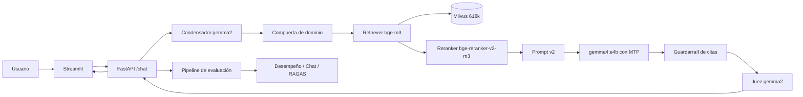

# Arquitectura del RAG

Fecha: 2026-11-01

## 1. Vista general

El sistema es un RAG sobre 618.286 fragmentos de prensa colombiana y Bluesky. La respuesta se construye con evidencia recuperada, un reranker, un generador local y dos capas de control: el guardarraíl de citas y el juez de evidencia. La compuerta de dominio es opcional y se activa con `Modo estricto`.

## 2. Capas

### 2.1 Corpus e ingesta

| Elemento | Valor |
|---|---|
| Colección | `rag_full_bge_m3_d1024_v1` |
| Fragmentos | 618.286 |
| Fuentes | `media_cloud` y `bluesky` |
| Estrategia de chunking | `fixed_v2` |
| Embedding | `BAAI/bge-m3`, 1024 dimensiones |
| Índice | HNSW en Milvus, `ef=800` |
| Almacenamiento | Milvus, etcd y MinIO |
| Metadatos | `document_id`, `title`, `url`, `source`, `language`, `created_at`, `position`, `chunk_strategy`, `text_sha256` |

Los documentos se limpian y fragmentan antes de la ingesta. La colección se valida contra la etiqueta del encoder activo (`bge_m3`) para evitar mezclar espacios vectoriales.

### 2.2 Recuperación

| Elemento | Valor |
|---|---|
| Recuperador principal | bge-m3 denso |
| `k` de respuesta | 5 |
| `k` de evaluación | 10 |
| `ef` | 800 |
| Recuperadores alternativos | sparse BM25 e híbrido con RRF |
| Reranker | `BAAI/bge-reranker-v2-m3` en CPU |
| Alcance del reranker | top-5 |

El recuperador denso devuelve los fragmentos; el reranker reordena el top-5 con un cross-encoder multilingüe. No añade ni quita documentos en la configuración actual. La fusión con BM25 queda como opción, pero no se usa porque en las pruebas bajó el recall.

### 2.3 Generación

| Elemento | Valor |
|---|---|
| Modelo | `gemma4:e4b` |
| Parámetros | 7,5B, Q4_K_M |
| Contexto | 116.384 tokens (16.384 de entrada y 100.000 de salida) |
| MTP | draft nativo, `draft_num_predict=3` |
| Prompt | `v2` |
| Razonamiento | nativo de gemma4, opcional |
| Salida | hasta 100.000 tokens, corta en EOS |

El MTP viene en el manifiesto del modelo. Ollama arranca llama-server con `--spec-type draft-mtp` y un draft compatible. La decodificación especulativa es exacta: el draft propone y el modelo objetivo verifica. El draft de 3 es el más rápido; 5 y 7 bajan el rendimiento.

### 2.4 Conversación

| Elemento | Valor |
|---|---|
| Historial | hasta 12 turnos en la API; la UI envía los últimos 8 |
| Condensador | `gemma2:2b` |
| Router | tool calling con `buscar_corpus` |
| Fallback | si el router no llama la herramienta, se recupera igual |
| Compuerta | clasificador de dominio, sin juez, opcional |

`condense_query` convierte un seguimiento ("¿Y en qué departamento?") en una consulta autónoma. Si el condensador se disculpa o pierde el tema, se antepone la primera pregunta del usuario. El router usa el modelo seleccionado; en `Modo estricto` se omite para ahorrar latencia.

### 2.5 Guardarraíles

| Control | Qué hace |
|---|---|
| Citas obligatorias | una respuesta de dominio sin cita se abstiene |
| Entidades y números | deben aparecer en el chunk citado o en la pregunta |
| Metadatos | título, fecha y URL del chunk citado cuentan como evidencia |
| Cambio de idioma | si el chunk está en inglés y la respuesta en español, se salta la cobertura léxica y decide el juez |
| Juez de evidencia | `gemma2:2b` verifica que la cita sostenga la respuesta |
| Compuerta de dominio | clasificador bge-m3 + logística; si la pregunta no es del corpus, se abstiene con `fuera_dominio` |

La compuerta se entrena con 160 preguntas: 60 de dominio y 100 de fuera. Usa embeddings bge-m3, features de retrieval y regresión logística. No es un LLM juez.

### 2.6 API

| Endpoint | Uso |
|---|---|
| `POST /chat` | conversación con historial, `think` y `strict` |
| `POST /ask` | respuesta sin historial |
| `POST /retrieve` | recuperación pura |
| `GET /health` | estado de Milvus y Ollama |
| `GET /models` | modelos disponibles |
| `GET /stats` | colecciones y número de fragmentos |

La API corre en el contenedor `api` con ROCm. El frontend Streamlit consume `/chat`.

### 2.7 Interfaz

La UI tiene configuración en la barra lateral (modelo, `k`, idioma, fechas, colección, razonamiento y `Modo estricto`), chat con historial, respuestas con chips de intención y guardarraíl, métricas de latencia, evidencias desplegables y un expander de razonamiento.

El tema sigue Material 3. Los tokens de color, forma, tipografía, elevación y movimiento viven en `src/rag/ui.py`; `.streamlit/config.toml` fija el esquema nativo. El interruptor `Modo noche` cambia a la paleta oscura generada desde la misma semilla, incluidos los menús desplegables y el calendario. El esquema claro se genera desde el verde `#1f6b57` y usa superficies tonales en lugar de sombras: `surface-container-low` para la respuesta, `secondary-container` para el mensaje del usuario, `tertiary-container` para avisos informativos y `error-container` para abstenciones. Las capturas están en `reports/figuras/ui_m3_vacio.png`, `ui_m3_chat.png`, `ui_m3_estricto.png` y `ui_m3_noche.png`. El contraste se verifica con `src/scripts/check_contrast.py`: las 22 combinaciones de ambos esquemas pasan WCAG AA.

### 2.8 Evaluación

| Componente | Qué mide |
|---|---|
| `eval_configuracion_final.py` | recuperación y respuesta sobre el gold |
| `eval_chat_cases.py` | 12 casos de chat, con y sin `Modo estricto` |
| `export_ragas_dataset.py` | exporta pregunta, respuesta, contextos y ground truth |
| `eval_ragas.py` | RAGAS con juez y embedding configurables |
| `run_evaluation.py` | pipeline completo y comparación contra la arquitectura anterior |

La fase de desempeño corre en el worker GPU (`ingest-rocm`, perfil `rocm`), que tiene ROCm y sus propios límites de memoria; así la API no carga una segunda copia de `bge-m3` ni del reranker. RAGAS corre en el contenedor `eval` con Python 3.12, RAGAS 0.4.3, LangChain 0.3 y `BAAI/bge-m3` en CPU. La comparación se guarda en `reports/tablas/evaluacion_comparativa.md`.

### 2.9 Despliegue

| Servicio | Función |
|---|---|
| `etcd` | metadatos de Milvus |
| `minio` | almacenamiento de Milvus |
| `milvus` | base vectorial |
| `ollama` | LLM, embeddings de Ollama y MTP |
| `api` | FastAPI y RAG |
| `frontend` | Streamlit |
| `eval` | RAGAS y evaluación aislada |

La API y el frontend usan `network_mode: host`. El contenedor `eval` se levanta con el perfil `eval` y monta `src`, `eval`, `reports`, `plan` y la caché de Hugging Face.

## 3. Configuración

| Variable | Valor |
|---|---|
| `LLM_MODEL` | `gemma4:e4b` |
| `JUDGE_MODEL` | `gemma2:2b` |
| `CONDENSE_MODEL` | `gemma2:2b` |
| `EMBEDDER` | `bge` |
| `EMBEDDINGS_MODEL` | `BAAI/bge-m3` |
| `EMBEDDINGS_DIMS` | `1024` |
| `EMBEDDING_DEVICE` | `cuda` |
| `EMBEDDING_HALF` | `true` |
| `RETRIEVER` | `dense` |
| `SEARCH_EF` | `800` |
| `TOP_K` | `5` |
| `RERANK` | `1` |
| `RERANK_MODEL` | `BAAI/bge-reranker-v2-m3` |
| `RERANK_DEVICE` | `cpu` |
| `DOMAIN_CLASSIFIER_PATH` | `modelos/domain_classifier.json` |
| `DOMAIN_THRESHOLD` | `0.5` |
| `MAX_CONTEXT_TOKENS` | `16384` |
| `GEMMA4_INPUT_TOKENS` | `16384` |
| `GEMMA4_OUTPUT_TOKENS` | `100000` |
| `MAX_OUTPUT_TOKENS` | `8192` |
| `REASONING_TOKENS` | `1024` |

## 4. Resultados

### 4.1 Recuperación

| Configuración | Recall | nDCG | P@1 | P@5 | span hit |
|---|---|---|---|---|---|
| Denso k=10 | 0,912 | 0,818 | 0,737 | 0,947 | 0,816 |
| Denso top-5 | 0,895 | 0,809 | 0,737 | 0,947 | 0,763 |
| Reranker top-5 | 0,895 | 0,865 | 0,868 | 0,947 | 0,763 |

El reranker sube nDCG y P@1 sin perder recall ni P@5. Por idioma, el reranker top-5 da en inglés 0,889 de recall, 0,817 de nDCG, 0,778 de P@1 y 0,889 de P@5; en español 0,897, 0,880, 0,897 y 0,966.

La corrección de spans de la revisión de Óscar se volvió a medir y `span_hit` se mantiene en 0,816.

### 4.2 Respuesta

| Métrica | Sin razonamiento | Con razonamiento |
|---|---|---|
| Directas entregadas | 37 de 38 | 37 de 38 |
| Abstenciones directas | 1 | 1 |
| Abstenciones en sin respuesta | 5 de 5 | 5 de 5 |
| Match estricto | 25 de 37 (67,6%) | 25 de 37 (67,6%) |
| F1 por tokens | 0,273 | 0,272 |
| Respuestas con cita | 100% | 100% |
| Contexto medio | 1.361 tokens | 1.361 tokens |
| Latencia media | 7.938 ms | 6.834 ms |
| Latencia mediana | 7.086 ms | 6.729 ms |

La revisión manual de las 12 respuestas no estrictas da 8 correctas, 3 parciales y 1 incorrecta: 33 de 37 equivalentes (89,2%) o 36 de 37 con parciales (97,3%). La incorrecta es g-046, donde el retrieval no trae Newcastle.

### 4.3 Chat

| Configuración | Aciertos | Charla | Dominio | Fuera |
|---|---|---|---|---|
| Sin Modo estricto | 11 de 14 | 6 de 6 | 4 de 4 | 1 de 4 |
| Con Modo estricto | 14 de 14 | 6 de 6 | 4 de 4 | 4 de 4 |

Con `Modo estricto`, los 4 casos de fuera se abstienen con `fuera_dominio` en 61 a 88 ms. Sin la compuerta, el corpus responde "capital de Francia", "Cien años" y "mundial 2022" porque contiene las respuestas.

### 4.4 Compuerta de dominio

| Métrica | Valor |
|---|---|
| Preguntas | 160 (60 dominio, 100 fuera) |
| Split | 103 train, 37 dev, 20 test |
| Modelo | regresión logística con bge-m3 y features de retrieval |
| Dev F1 | 1,000 |
| Test objetivo (4 fuera + 11 dominio nuevo) | 14 de 15 |
| Test completo | F1 0,952 |
| Falsos rechazos de dominio | 0,091 |
| Falsos aceptados de fuera | 0,000 |

La ampliación añadió 40 negativos duros: entidades inventadas, eventos futuros y conocimiento general fuera del corpus. Los 5 casos sin respuesta ahora se rechazan con probabilidades 0,293 a 0,436. El único falso rechazo es «¿Cuánto se aceleró la inflación en Colombia?», en 0,494. El umbral sigue en 0,5 porque el margen de dev va de 0,456 a 0,559.

### 4.5 RAGAS

| Métrica | Actual (`gemma4` + `bge-m3`) | Anterior (`gemma2` + `qwen3`) |
|---|---|---|
| Faithfulness | 0,952 (n=38) | 0,925 (n=36) |
| Answer relevancy | 0,840 (n=38) | 0,798 (n=38) |
| Context precision | 0,881 (n=34) | 0,760 (n=36) |
| Context recall | 0,921 (n=38) | 0,842 (n=38) |
| Answer correctness | 0,657 (n=38) | 0,705 (n=37) |

El juez y el embedding cambiaron, así que la comparación no es completamente equivalente. La arquitectura actual gana en faithfulness, answer relevancy, context precision y context recall; pierde en answer correctness. La corrida de referencia usa `RAGAS_TIMEOUT=900` y `RAGAS_WORKERS=6`: con el timeout por defecto de 180 s, `context precision` quedaba con 4 valores de 38 y no era comparable. La mejora pendiente es la corrección de respuesta.

### 4.6 Arquitectura anterior contra actual

| Frente | Actual | Anterior |
|---|---|---|
| Recuperación | k=5, reranker top-5 | k=15, sin reranker |
| Entregadas | 37 de 38 | 33 de 38 |
| Abstenciones directas | 1 | 5 |
| Match estricto | 25 de 37 (67,6%) | 24 de 33 (72,7%) |
| Revisión manual | 33 de 37 (89,2%) | 32 de 37 (86,5%) |
| Chat con Modo estricto | 14 de 14 | 9 de 12 |
| Latencia media | 7.938 ms | 17.657 ms |
| Contexto medio | 1.361 | 3.975 |

La arquitectura actual entrega más respuestas, acierta más en la revisión manual y es 2,6 veces más rápida. El coste es un contexto más corto y una corrección de respuesta algo menor.

### 4.7 MTP y latencia

| Draft | Tokens por segundo |
|---|---|
| 3 | 217,1 |
| 5 | 193,5 |
| 7 | 159,5 |

El MTP ya estaba activo. La mayor ganancia de latencia vino de alinear el contexto del router con el del generador: antes el router usaba 8K y el generador 116K, y Ollama recargaba el modelo. El reranker en CPU añade 1,1 s. La primera consulta de una sesión tarda unos 29 s por la carga.

## 5. Limitaciones

- La revisión manual la hizo un solo anotador.
- El gold tiene 43 preguntas; los intervalos de confianza no se reportan.
- RAGAS con el timeout por defecto de 180 s dejaba `context precision` con 4 valores de 38. La corrida de referencia usa 900 s y 6 workers.
- La compuerta deja pasar 3 de los 5 casos sin respuesta; el RAG se abstiene en los 5.
- El contexto de 116K usa 13,9 GB de VRAM y deja 3,2 GB libres.
- La primera consulta tarda unos 29 s; conviene precalentar la demo.

## 6. Artefactos

- `plan/evaluacion_dominio_ragas.md`: plan por fases.
- `reports/informe/metricas_nueva_configuracion.md`: informe de métricas.
- `reports/tablas/evaluacion_comparativa.md`: comparación actual contra anterior.
- `reports/tablas/ragas_gemma4-e4b_bge-m3.csv`: RAGAS actual con timeout corregido.
- `reports/tablas/ragas_gemma4-e4b_bge-m3_run1.csv` y `_run2.csv`: corridas con el timeout anterior.
- `reports/tablas/ragas_gemma2-2b.csv`: RAGAS de la arquitectura anterior.
- `reports/tablas/metricas_final_sin.csv` y `metricas_final_con.csv`: respuesta final.
- `reports/tablas/metricas_rerank_top5.csv`: denso contra reranker.
- `reports/tablas/chat_eval_final_sin_strict.csv` y `chat_eval_final_con_strict.csv`: chat.
- `modelos/domain_classifier.json`: compuerta.
- `eval/domain/domain_questions.jsonl`: 160 preguntas de la compuerta.

## 7. Fase 6. Mejoras probadas

Se probaron cuatro mejoras sobre el gold de 38 preguntas. La referencia es el top-5 con reranker y el prompt v2.

| Mejora | Resultado | Decisión |
|---|---|---|
| Filtro del top-5 por score del reranker | recall 0,838/0,825; P@5 0,921; nDCG 0,837/0,830 | Rechazada |
| Rerank del top-20 al top-5 | recall 0,864; P@5 0,921; nDCG 0,853; 5,46 s | Rechazada |
| Expansión de consulta con RRF | recall 0,825; P@5 0,895; nDCG 0,739 | Rechazada |
| Prompt v4 para fechas | 37/38; 25/37; F1 0,273; 6,98 s | Rechazada |

Ninguna supera al top-5 con reranker. La configuración final se mantiene: `k=5`, reranker top-5, sin filtro, sin expansión y prompt v2. Los detalles están en `reports/tablas/mejoras_recuperacion.csv` y `metricas_v4_sin.csv`.

### 7.1 Diversidad (MMR)

Se probó MMR sobre el top-20 con relevancia por coseno y por score del reranker. Ninguna variante supera al top-5 con reranker: la mejor baja de 0,895 a 0,816 de recall y de 0,947 a 0,921 de P@5, y tarda 4,06 s frente a 1,03 s. Se rechaza.

El diagnóstico de los dos fallos queda así: g-031 aparece en el puesto 11 del denso top-50 y en el 1 tras el reranker, así que un pool mayor lo recuperaría a costa de 3,1 puntos de recall global; g-046 no aparece ni en el top-50, así que el problema está en la consulta o en el índice.
