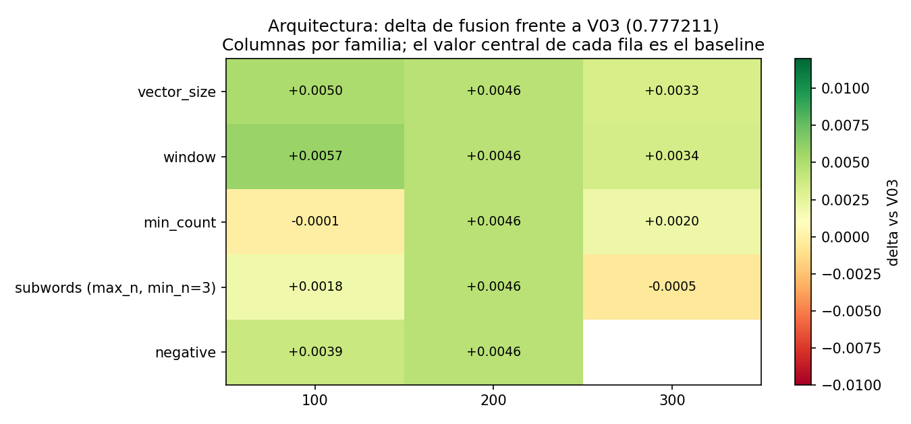
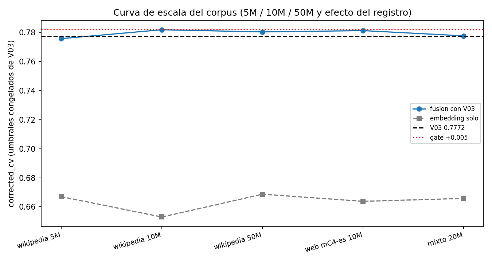

# P6 de v5.1: comparacion final de la arquitectura (EBD-23)

Generado por `experiments/embedding_17_comparacion_final_v5_1.py` (EBD-23 (P6)).
No entrena nada: consolida los resultados de P1 a P5.

## 1. Tabla maestra

Una fila por configuracion medida. `embedding_cv` es el bloque denso solo (media +
LR, umbrales congelados de V03) y `fusion_cv` es la union con el bloque disperso de
V03, que es la evaluacion critica. El baseline aparece en las cinco filas porque se
reevalua en cada familia como control; es **una** unidad de entrenamiento, no cinco.

| familia | valor | embedding_cv | fusion_cv | delta | IC95 | adoptable |
|---|---|---|---|---|---|---|
| vector_size | 200 (baseline) | 0.6523 | 0.7818 | +0.0046 | [-0.003161, 0.012409] | no |
| vector_size | 100 | 0.6420 | 0.7823 | +0.0050 | [-0.00282, 0.013005] | no |
| vector_size | 300 | 0.6516 | 0.7805 | +0.0033 | [-0.004252, 0.010929] | no |
| window | 5 (baseline) | 0.6523 | 0.7818 | +0.0046 | [-0.003161, 0.012409] | no |
| window | 3 | 0.6694 | 0.7830 | +0.0057 | [-0.002084, 0.013625] | no |
| window | 7 | 0.6498 | 0.7806 | +0.0034 | [-0.00397, 0.011021] | no |
| min_count | 3 (baseline) | 0.6523 | 0.7818 | +0.0046 | [-0.003161, 0.012409] | no |
| min_count | 2 | 0.6516 | 0.7771 | -0.0001 | [-0.007988, 0.007831] | no |
| min_count | 5 | 0.6547 | 0.7792 | +0.0020 | [-0.005623, 0.009722] | no |
| subwords | 6 (baseline) | 0.6523 | 0.7818 | +0.0046 | [-0.003161, 0.012409] | no |
| subwords | 5 | 0.6397 | 0.7791 | +0.0018 | [-0.005262, 0.009182] | no |
| subwords | 7 | 0.6465 | 0.7767 | -0.0005 | [-0.008431, 0.007485] | no |
| negative | 10 (baseline) | 0.6523 | 0.7818 | +0.0046 | [-0.003161, 0.012409] | no |
| negative | 5 | 0.6664 | 0.7811 | +0.0039 | [-0.004356, 0.012308] | no |

**Rango total**: 14 configuraciones, 14 celdas de fusion, 0 adoptables.
El embedding aislado se mueve entre 0.6397 y 0.6694 (rango 0.0297);
la fusion se mueve entre 0.7767 y 0.7830 (rango 0.0063).
El rango del embedding aislado es **4.8 veces mayor** que el de la fusion: la
arquitectura cambia lo que se puede leer del embedding, pero casi nada de lo que
aporta a la tarea.

## 2. Mapa de calor

## 3. Conclusion de representacion

La arquitectura **si** cambia la calidad de la representacion. El embedding aislado
va de 0.6397 a 0.6694 entre las 14
configuraciones medidas. La mejor celda es WS-3 (familia
window, valor 3) con 0.6694,
y su forma es reveladora: **gana reduciendo la ventana de contexto** y no acortando
el intervalo de subpalabra, que se queda en el central 3-6. Acortar las subpalabras
empeora (3-5 da 0.6397) y alargarlas tambien (3-7 da 0.6465), de modo que el optimo
esta en el punto medio del intervalo y en el extremo **bajo** de la ventana: la
señal util es local y ortografica, no una ventana de distribucion amplia. Los slices
lo confirman: las mejoras se concentran en elongaciones, URLs y hashtags, que es donde
la forma de la palabra importa.

## 4. Conclusion de tarea

Ninguna configuracion aporta informacion adicional a V03 por encima del gate. El
mejor delta de toda la tabla es +0.0057, con intervalo
de confianza que incluye el 0. Las nueve configuraciones nuevas se mueven en un rango
de 0.0063, que es del orden del ruido del
protocolo. **V03 se mantiene.**

## 5. Curva de escala

La curva viene de v5 y no se reinterpola: solo se dibujan puntos observados. No hay
tendencia que autorice un escalado del corpus (seccion 12 de la spec).

## 6. Archivos

- `reports/embedding_architecture_maestra_v5_1.csv` (esta tabla en CSV)
- `reports/embedding_capacity_analysis_v5_1.md` (conclusion de representacion)
- `reports/embedding_scaling_conclusion_v5_1.md` (conclusion de escalado)
- `reports/embedding_architecture_auditoria_v5_1.md` (contabilidad de P0)

Fecha: 2026-09-26T00:28:12+00:00.
