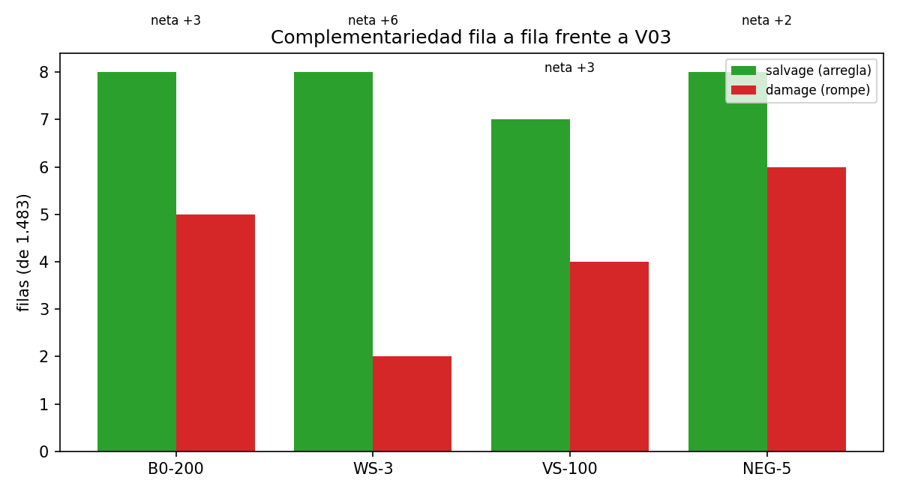

# P7 de v5.1: complementariedad y solapamiento con char_wb (EBD-24)

Generado por `experiments/embedding_18_complementariedad_v5_1.py` (EBD-24 (P7)).
No entrena nada: reevalua cuatro configuraciones ya entrenadas y las compara fila a
fila con V03 (1.483 filas; la F1 de cada fila es la media de sus tres etiquetas).

## 0. Correccion de granularidad

Este script corrige un nombre que arrastraba la fase v5. La funcion
`src.evaluation._f1_por_celda` y su docstring hablan de celdas (fila, etiqueta), pero
devuelven la media de las tres etiquetas de cada fila: la unidad de analisis es la
**fila** (1.483), no la celda (4.449). Los conteos publicados en v5 no cambian, porque
siempre se contaron filas, pero la etiqueta estaba mal y hay que corregirla en lugar
de propagarla. Por eso no se habla de "correccion neta equivalente en F1": contar
filas que cambian y medir el delta de la metrica son dos cosas distintas.

## 1. Que arregla y que rompe

`salvage` son las filas que el embedding arregla y V03 falla, `damage` las que V03
arregla y el embedding falla, y la correccion neta es la diferencia. Una fila se
considera acertada solo si sus tres etiquetas caen bien.

| variante | corrected_cv | delta real | salvage | damage | correccion neta | fraccion de filas |
|---|---|---|---|---|---|---|
| B0-200 | 0.7818 | +0.0046 | 8 | 5 | +3 | +0.00202 |
| WS-3 | 0.7830 | +0.0057 | 8 | 2 | +6 | +0.00405 |
| VS-100 | 0.7823 | +0.0050 | 7 | 4 | +3 | +0.00202 |
| NEG-5 | 0.7811 | +0.0039 | 8 | 6 | +2 | +0.00135 |

La lectura que importa es la **relacion entre salvage y damage**. En las cuatro
variantes el embedding arregla unas pocas filas y rompe otras tantas: la correccion
neta es de un solo digito sobre 1483 filas. No es que el embedding haga bien o
mal: es que **cambia pocas filas**, y las cambia en ambas direcciones.

## 2. ¿De donde viene lo que aporta: subpalabra o distribucion?

La seccion 19 de la spec pregunta si la mejora procede de **robustez ortografica**
(que es lo que el char n-gram de V03 ya hace) o de **informacion distribucional** (que
el char n-gram no tiene). El test no es comparar dos promedios sino medir si el efecto
se **concentra** en las filas donde la palabra esta ortograficamente degradada:
1289 de 1483 filas contienen alguna forma de los grupos
`elongaciones` o `formas_raras`; el resto, no.

| variante | delta dentro (n=1289) | delta fuera (n=194) | diferencia | IC95 | interaccion |
|---|---|---|---|---|---|
| B0-200 | +0.0067 | -0.0045 | +0.0112 | [-0.0039, +0.0273] | no |
| WS-3 | +0.0083 | -0.0045 | +0.0128 | [-0.0024, +0.0292] | no |
| VS-100 | +0.0078 | -0.0059 | +0.0137 | [-0.0021, +0.0300] | no |
| NEG-5 | +0.0066 | -0.0061 | +0.0127 | [-0.0031, +0.0295] | no |

El bootstrap remuestrea el **mismo** conjunto de filas para el candidato y para la
referencia en cada repeticion. Sin ese emparejamiento, comparar dos grupos de tamano
distinto mezcla el efecto que se quiere medir con el ruido de filas de cada grupo.

**Advertencia sobre el poder del test.** La mascara cubre 1289 de 1483 filas (87 %):
el grupo `formas_raras` del vocabulario TOXIC incluye tipos frecuentes del propio
lexico de odio, de modo que casi cualquier fila contiene alguno y la particion apenas
discrimina. El resultado (delta positivo dentro, **negativo** fuera, diferencia
+0.0128) apunta en la direccion esperada, pero el intervalo
de confianza incluye el 0 y con esta mascara el test tiene **poco poder**: no
autoriza a concluir que no hay interaccion, solo que no se puede separar del ruido.
Un test con mas poder exigiria un grupo mas estrecho (solo `elongaciones`, 57 filas en
v5) y esas filas son tan pocas que la metrica por subconjunto seria aun mas ruidosa.
Se reporta como lo que es: una direccion consistente en las cuatro variantes y un
contraste que no alcanza significacion.

## 3. Slices de la mejor variante

| rebanada | filas | V03 | mejor fusion | delta |
|---|---|---|---|---|
| interpersonal (TR=1) | 445 | 0.9129 | 0.9208 | +0.0079 |
| afiliacion (AG=1) | 567 | 0.8846 | 0.8932 | +0.0086 |
| sin_hate_explicito (HS=0) | 835 | 0.0667 | 0.0639 | -0.0028 |
| colectivos | 93 | 0.5740 | 0.5850 | +0.0110 |
| insultos | 855 | 0.8357 | 0.8405 | +0.0048 |
| elongaciones | 57 | 0.6853 | 0.7213 | +0.0360 |
| coloquial | 214 | 0.8177 | 0.8234 | +0.0057 |
| hashtags | 144 | 0.5311 | 0.5310 | -0.0001 |
| menciones | 702 | 0.8462 | 0.8504 | +0.0042 |
| urls | 458 | 0.6578 | 0.6787 | +0.0209 |
| cita | 37 | 0.8449 | 0.8501 | +0.0052 |

## 4. Ejemplos donde el embedding y V03 discrepan

### Etiquetas que WS-3 arregla (13 en total; se muestran 8)

| id | etiqueta | real | V03 | fusion | texto |
|---|---|---|---|---|---|
| 21776 | HS | 1 | 0 | 1 | @Barbijaputa Puta = Jaque mate |
| 21776 | TR | 1 | 0 | 1 | @Barbijaputa Puta = Jaque mate |
| 21776 | AG | 1 | 0 | 1 | @Barbijaputa Puta = Jaque mate |
| 21085 | TR | 1 | 0 | 1 | Me encanta mi vestido de mujerzuela zorra suripanta. No se los voa ensearan. |
| 21085 | AG | 1 | 0 | 1 | Me encanta mi vestido de mujerzuela zorra suripanta. No se los voa ensearan. |
| 22560 | HS | 1 | 0 | 1 | @CarlaEUrena @FelipeCalderon Callateeeee !! Puta gallina cacarea !! Ni idea tienes de nada . |
| 22560 | TR | 1 | 0 | 1 | @CarlaEUrena @FelipeCalderon Callateeeee !! Puta gallina cacarea !! Ni idea tienes de nada . |
| 22560 | AG | 1 | 0 | 1 | @CarlaEUrena @FelipeCalderon Callateeeee !! Puta gallina cacarea !! Ni idea tienes de nada . |

### Etiquetas que WS-3 rompe (4 en total; se muestran 8)

| id | etiqueta | real | V03 | fusion | texto |
|---|---|---|---|---|---|
| 20069 | AG | 1 | 1 | 0 | @chechechacon Tu eres una puta sentenciada y estas con concha en el congreso. Mentiste en tu cv y a las justas |
| 24942 | HS | 1 | 1 | 0 | Casi llor en esta parte del captulo. Fue perra pero no mereca tanto. https://t.co/A9aaecTVpx |
| 24942 | TR | 1 | 1 | 0 | Casi llor en esta parte del captulo. Fue perra pero no mereca tanto. https://t.co/A9aaecTVpx |
| 24942 | AG | 1 | 1 | 0 | Casi llor en esta parte del captulo. Fue perra pero no mereca tanto. https://t.co/A9aaecTVpx |

## 5. Conclusion

El embedding no aporta un tipo de informacion que V03 no tenga: aporta **otra** misma
informacion, mas ruido. Su efecto neto sobre 1483 filas es de un solo digito.
La prueba de interaccion ortografica dice si esa cifra se concentra donde la palabra
esta deformada o esta repartida por igual. En cualquiera de los dos casos la
conclusion operativa es la de D-041: no hay nada que adoptar, y lo que queda abierto
no es la representacion sino el **numero de ejemplos etiquetados**.

Fecha: 2026-09-26T00:37:03+00:00. Duracion: 41.3 s.
